

<picture>
  <source media="(max-width: 1103px)" srcset="assets/banners/banner-mobile.png">
  
</picture>

 

A **MWX Systems** desenvolve sistemas para organizações de GTA Roleplay no Discord. Atendimento, recrutamento, expediente, farm, encomendas, denúncias e moderação organizados no próprio servidor, com registro de cada ação, em português e com a identidade da sua organização.

 

<picture>
  <source media="(max-width: 1103px)" srcset="assets/branding/painel-topo-mobile.svg">
  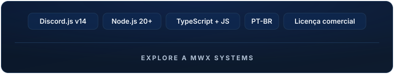
</picture>
 
<a href="#nossos-sistemas">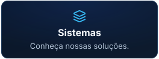</a>
<a href="#demonstrações">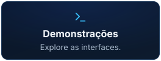</a>
<a href="#diferenciais">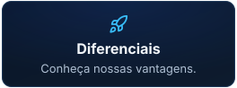</a>
<a href="#planos">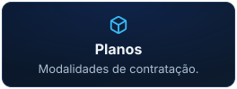</a>
<a href="#documentação">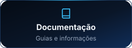</a>
<a href="#contato">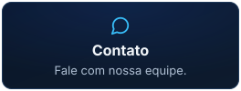</a>

 

> [!NOTE]
> Este repositório é a vitrine dos sistemas MWX. Os planos dão direito ao uso dos sistemas. O código-fonte não está incluso.

 

<picture></picture>

## Nossos sistemas

Seis sistemas independentes que trabalham juntos. Clique em um card para ver funções, comandos e requisitos.

<a href="docs/bots/atendimento.md">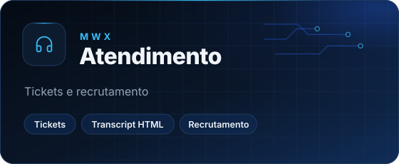</a>

 

<picture></picture>

## Módulos adicionais

Funções extras que se somam ao MWX Management. **Não fazem parte dos planos**: são contratadas à parte, sob orçamento. [Ver detalhes](docs/bots/extras.md)

<a href="docs/bots/extras.md">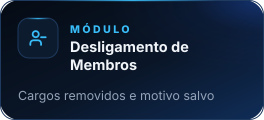</a>
<a href="docs/bots/extras.md">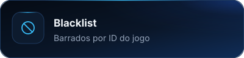</a>

 

<picture></picture>

## Demonstrações

Atendimento · Recrutamento · Bate-Ponto · Farm · Encomendas · Management · Denúncias

<a href="docs/bots/management.md">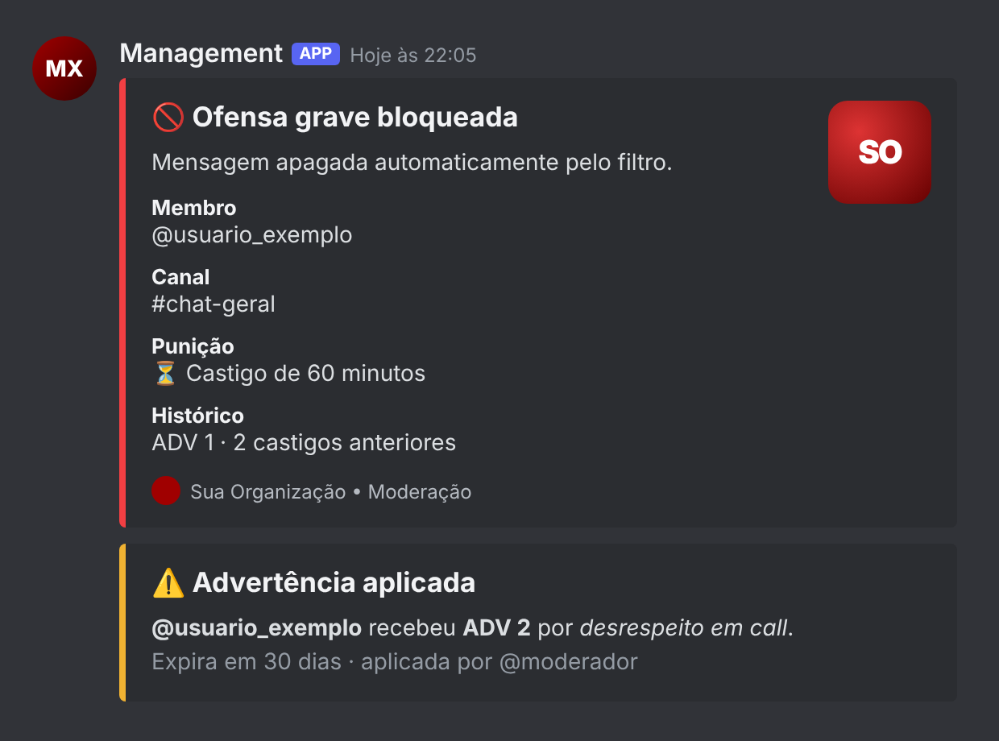</a>

<a href="docs/bots/denuncias.md">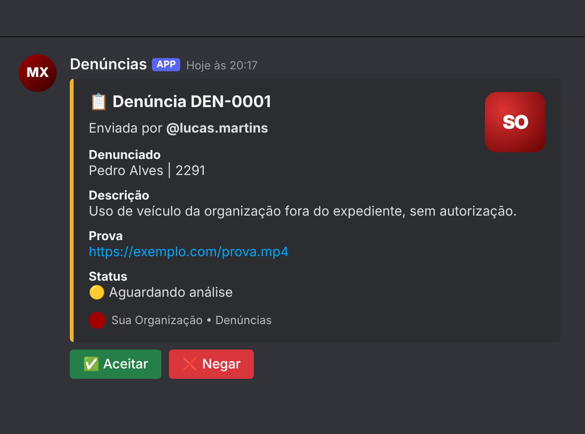</a>

Imagens ilustrativas das interfaces, com dados fictícios. Cores, nome e ícone mudam conforme o servidor.

<!-- GIFs: salve em assets/telas/gifs/<sistema>.gif e troque a imagem correspondente. Veja assets/telas/gifs/README.md. -->

 

<picture></picture>

## Diferenciais

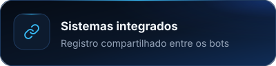
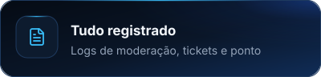

 

<picture></picture>

## Planos

### Planos de assinatura

Soluções integradas para sua organização. Valores mensais por servidor, com hospedagem, suporte e atualizações inclusos. [Detalhes dos planos](docs/planos.md) · [Contratar](#contato)

<a href="docs/planos.md">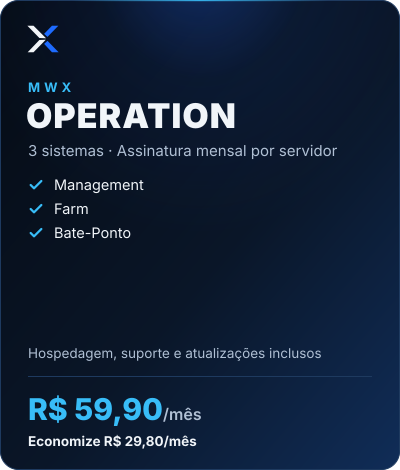</a>

<a href="docs/planos.md">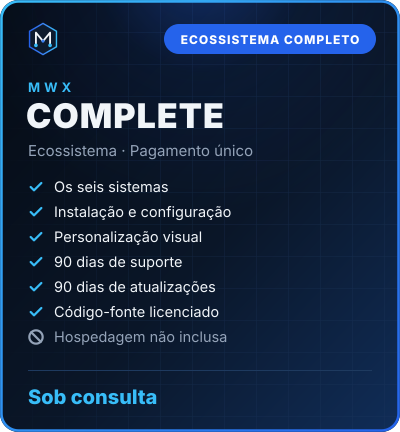</a>

<b>Ver os planos de assinatura em texto</b>

 

| Plano | Sistemas | Valor mensal | Economia |
|---|---|---|---|
| MWX Essential | Management · Atendimento / Ticket | R$ 49,90 | R$ 9,90/mês |
| MWX Operation | Management · Farm · Bate-Ponto | R$ 59,90 | R$ 29,80/mês |
| MWX Professional | Management · Atendimento / Ticket · Farm · Bate-Ponto | R$ 79,90 | R$ 34,70/mês |
| **MWX Complete** | Os seis sistemas | **R$ 99,90** | R$ 49,50/mês |

A economia é a diferença para a soma dos mesmos sistemas contratados individualmente.

### Sistemas individuais

Assinatura mensal por servidor, para contratar só o sistema que precisa.

| Sistema | Valor mensal |
|---|---|
| [MWX Management](docs/bots/management.md) | R$ 34,90 |
| [MWX Atendimento / Ticket](docs/bots/atendimento.md) | R$ 24,90 |
| [MWX Encomendas](docs/bots/encomendas.md) | R$ 19,90 |
| [MWX Farm](docs/bots/farm.md) | R$ 24,90 |
| [MWX Bate-Ponto](docs/bots/ponto.md) | R$ 29,90 |
| [MWX Denúncias](docs/bots/denuncias.md) | R$ 14,90 |

### Outras modalidades

- **Licença em pagamento único:** valor sob consulta. Concede direito de uso por tempo indeterminado, conforme as condições comerciais e contratuais da MWX Systems.
- **MWX Custom:** projetos personalizados sob orçamento, com condições definidas individualmente.

> [!IMPORTANT]
> **Código-fonte não incluso.** Nenhum plano inclui o código-fonte ou a propriedade intelectual dos sistemas, e o direito de uso não autoriza revenda ou redistribuição. Nas assinaturas, o uso vale enquanto a assinatura estiver ativa. Na licença em pagamento único, o direito de uso por tempo indeterminado não significa suporte, hospedagem ou atualizações vitalícios. O código-fonte só é adquirido mediante negociação comercial separada, inclusive em projetos Custom. [Falar com a MWX](#contato)

 

<picture></picture>

## Como contratar

 

<picture></picture>

## Documentação

**Sistemas:** [Management](docs/bots/management.md) · [Atendimento](docs/bots/atendimento.md) · [Bate-Ponto](docs/bots/ponto.md) · [Farm](docs/bots/farm.md) · [Encomendas](docs/bots/encomendas.md) · [Denúncias](docs/bots/denuncias.md) · [Módulos adicionais](docs/bots/extras.md)

**Guias:** [Comandos](docs/comandos.md) · [Requisitos e instalação](docs/instalacao.md) · [Planos](docs/planos.md) · [Perguntas frequentes](docs/faq.md)

 

## Perguntas frequentes

<picture>
  <source media="(max-width: 1103px)" srcset="assets/branding/faq-topo-mobile.svg">
  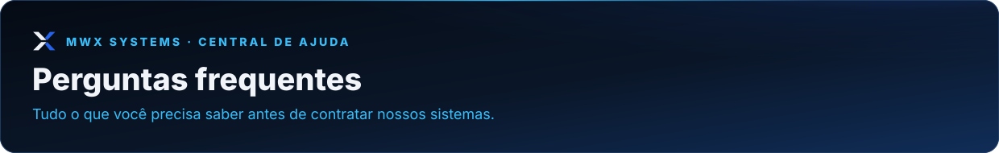
</picture>

<b>Os sistemas servem para o meu servidor de RP?</b>

 
Foram feitos para organizações de RP no Discord, como facção, polícia, hospital, mecânica ou empresa. Textos, canais e cargos são configuráveis. Para um caso específico, confirme no atendimento comercial.

<b>O que estou contratando? O código-fonte vem junto?</b>

 
O direito de uso dos sistemas no seu servidor. Nas assinaturas, ele vale enquanto a assinatura estiver ativa, com hospedagem, suporte e atualizações inclusos. Na licença em pagamento único, o direito de uso é por tempo indeterminado, conforme as condições comerciais e contratuais da MWX Systems, e não significa suporte, hospedagem ou atualizações vitalícios. Em nenhum caso há aquisição da propriedade intelectual, o código-fonte não está incluso e revenda ou redistribuição não são permitidas. O código-fonte só é adquirido mediante negociação comercial separada com a MWX Systems.

<b>Onde os sistemas ficam hospedados?</b>

 
Nos planos de assinatura e nos sistemas individuais, a hospedagem está inclusa. Na licença em pagamento único, a hospedagem não está inclusa: os sistemas rodam na sua hospedagem (PC ligado 24h, VPS ou painel de hospedagem de bots).

<b>Por quanto tempo tenho suporte e atualizações?</b>

 
Nas assinaturas, suporte e atualizações estão inclusos enquanto a assinatura estiver ativa. Na licença em pagamento único e no MWX Custom, o período é definido na contratação.

<b>Posso personalizar a identidade dos sistemas?</b>

 
Sim. Os painéis usam o nome, as cores e o banner da sua organização.

<b>Preciso saber programar?</b>

 
Não. A instalação e a configuração fazem parte dos planos, e os ajustes do dia a dia são feitos por comandos no Discord.

<a href="#contato">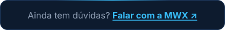</a>

<a href="docs/faq.md">Mais perguntas, incluindo as técnicas</a>

 

<picture></picture>

## Contato

<picture>
  <source media="(max-width: 1103px)" srcset="assets/branding/contato-mobile.svg">
  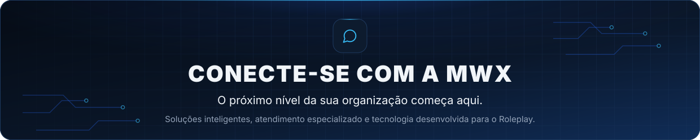
</picture>

O Discord é o canal principal para orçamentos e suporte. Responsável: <b>niklausx_</b> · E-mail: <b>contato.mwxsystems@gmail.com</b> · Atendimento em português

 

<picture>
  <source media="(max-width: 1103px)" srcset="assets/branding/rodape-mobile.svg">
  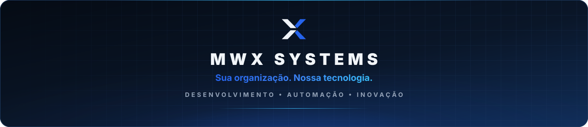
</picture>

© 2026 MWX Systems. Todos os direitos reservados. Veja a <a href="LICENSE.md">licença</a>. Discord é marca da Discord Inc. A MWX Systems não é afiliada ao Discord.

