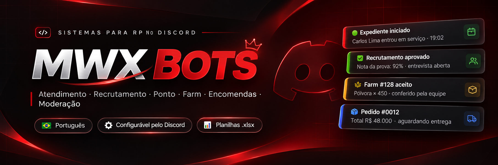
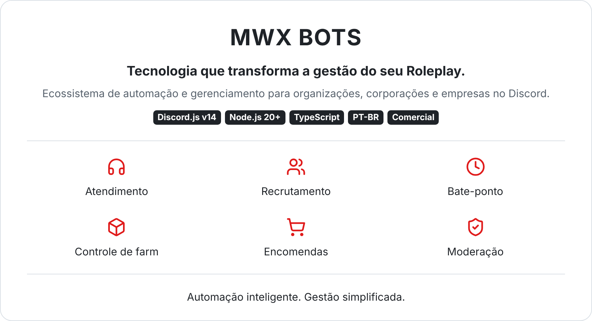

  

  <picture>
    <source media="(prefers-color-scheme: dark)" srcset="assets/apresentacao-escura.png">
    
  </picture>

---

> **Este repositório é uma vitrine.** Aqui você vê o que cada bot faz, os comandos e as telas.
> O código-fonte é entregue somente aos clientes, sob licença de uso. Veja [Planos](docs/planos.md).

## Por que usar

- **Tudo em português**, com textos pensados para RP: cidadão, recrutamento, cúpula, farm, expediente.
- **Configurado pelo próprio Discord.** Nenhum ID fixo no código: canais, cargos e categorias são escolhidos por comandos `/config-*`.
- **Visual padronizado.** Painéis com o ícone do seu servidor, sua cor e seu nome no rodapé.
- **Prova de tudo.** Logs de cada ação, transcript HTML dos tickets e planilhas `.xlsx` de horas e farm.
- **Estável.** Travas contra clique duplo, gravação segura dos dados, religamento automático e testes automatizados.
- **Modular.** Compre só o que precisa. Os bots conversam entre si quando instalados juntos.

## Os bots

| | Bot | O que resolve | Banco |
|---|---|---|---|
| 🛡️ | [**Management**](docs/bots/management.md) | Moderação, advertências, filtros, registro de membros, ausências, anúncios e estrutura do servidor | Arquivo JSON |
| 🎫 | [**Atendimento**](docs/bots/atendimento.md) | Tickets por assunto com transcript HTML e **recrutamento** com perguntas, prova e entrevista | Arquivo JSON |
| ⏱️ | [**Bate-Ponto**](docs/bots/ponto.md) | Expediente com iniciar/pausar/encerrar, cargo em serviço, ranking e planilha de horas | PostgreSQL |
| 🌾 | [**Farm**](docs/bots/farm.md) | Registro de farm com print, análise da equipe, metas e TOP do mês com planilha | Arquivo JSON |
| 📦 | [**Encomendas**](docs/bots/encomendas.md) | Catálogo, carrinho, valor total, ticket automático e entrega acompanhada | PostgreSQL |
| 🚨 | [**Denúncias**](docs/bots/denuncias.md) | Denúncias com protocolo, prova, análise da staff e resposta por DM | Arquivo JSON |

Também sob encomenda: **Controle de Efetivo**, **Confirmação de presença por DM**, **DM em massa** e **Desligamento de membros**. Veja [Módulos extras](docs/bots/extras.md).

## Telas

<table>
  <tr>
    <td width="50%"> Painel de atendimento</td>
    <td width="50%"> Recrutamento com nota da prova</td>
  </tr>
  <tr>
    <td> Bate-ponto e ranking de horas</td>
    <td> Registro e análise de farm</td>
  </tr>
  <tr>
    <td> Resumo de encomenda</td>
    <td> Log de moderação</td>
  </tr>
</table>

Telas com dados fictícios. Cores, nome e ícone mudam conforme o seu servidor.

## Comandos

A lista completa, bot por bot, está em [docs/comandos.md](docs/comandos.md). Um resumo:

| Bot | Principais comandos |
|---|---|
| Management | `/advertir` `/castigo` `/banir` `/registro` `/ausencia` `/anuncio` `/filtro` `/setup-servidor` |
| Atendimento | `/config-ticket` `/config-recrutamento` `/tickets-painel` `/ticket-assumir` `/ticket-fechar` |
| Bate-Ponto | `/config-ponto` `/painel-ponto` `/horas-ponto` `/ranking-ponto` `/relatorio-ponto` |
| Farm | `/farm-setup` `/config-farm` `/painelfarm` `/farm-planilha` |
| Encomendas | `/config-encomenda` `/produtos-encomenda` `/painel-encomenda` |

## Como funciona a contratação

1. **Conversa:** você diz qual organização é e quais bots quer.
2. **Instalação:** colocamos os bots no seu servidor (ou entregamos o pacote para você hospedar).
3. **Configuração:** canais, cargos, cores e textos ajustados ao seu RP.
4. **Suporte:** ajustes e atualizações conforme o plano.

Detalhes técnicos em [docs/instalacao.md](docs/instalacao.md) e dúvidas em [docs/faq.md](docs/faq.md).

## Planos

| Plano | Para quem | Valor |
|---|---|---|
| **Bot avulso** | Precisa de um sistema só | `R$ ___` |
| **Pacote completo** | Os 6 bots, configurados | `R$ ___` |
| **Aluguel mensal** | Hospedagem + suporte inclusos | `R$ ___ /mês` |

Comparativo completo em [docs/planos.md](docs/planos.md).

## Contato

- **Discord:** `SEU_USUARIO` · servidor de suporte: `https://discord.gg/SEU_CONVITE`
- **E-mail / WhatsApp:** `SEU_CONTATO`

---

© MWX Bots. Todos os direitos reservados. Discord é marca da Discord Inc.; este projeto não é afiliado ao Discord.

