

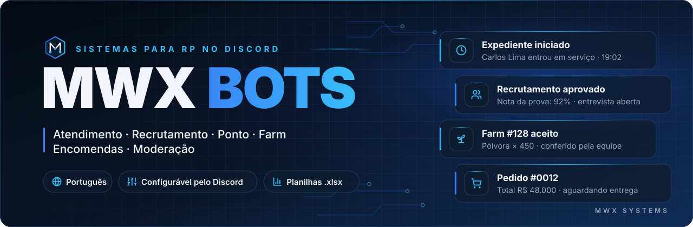

 

### Tecnologia que transforma a gestão do seu Roleplay.

A **MWX Systems** desenvolve sistemas para organizações de GTA Roleplay no Discord. 
Atendimento, recrutamento, expediente, produção, vendas e moderação, em português e com a identidade do seu servidor.

 

&nbsp;
&nbsp;
&nbsp;
&nbsp;

  

 

> [!NOTE]
> Este repositório é a vitrine dos sistemas MWX. O código-fonte é entregue somente aos clientes, sob licença de uso.

 

## Nossos sistemas

Seis sistemas independentes que trabalham juntos. Contrate um ou o ecossistema completo.

<table>
<tr>
<td width="50%" valign="top">

Moderação, registro de membros, ausências e organização do servidor em um único sistema.

<ul>
<li>Advertências com cargos e ação automática ao atingir o limite</li>
<li>Filtros de convites, links, palavrões e ofensas graves</li>
<li>Registro com apelido padronizado e aprovação da staff</li>
<li>Ausências com aprovação e encerramento automático</li>
<li>Anúncios com prévia e montagem da estrutura do servidor</li>
</ul>

<b>Para a organização:</b> moderação com histórico de cada membro e menos trabalho manual para a liderança.

<a href="docs/bots/management.md"><b>Ver documentação →</b></a>

</td>
<td width="50%" valign="top">

Atendimento privado por assunto e recrutamento completo, do formulário à entrevista.

<ul>
<li>Painéis público e interno, com um tipo de ticket por categoria</li>
<li>Transcript HTML no canal de registros, no log e na DM do cliente</li>
<li>Recrutamento com perguntas abertas e prova de regras A–E</li>
<li>Card para a staff com a porcentagem de acertos</li>
<li>Cargo de espera e ticket de entrevista abertos sozinhos</li>
</ul>

<b>Para a organização:</b> todo atendimento fica registrado e todo candidato passa pelo mesmo processo.

<a href="docs/bots/atendimento.md"><b>Ver documentação →</b></a>

</td>
</tr>
<tr>
<td width="50%" valign="top">
<a href="docs/bots/ponto.md">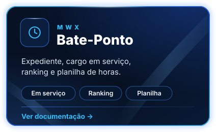</a>

Controle de expediente para polícia, hospital, mecânica, facção ou empresa.

<ul>
<li>Painel com Iniciar, Pausar / Retornar e Encerrar</li>
<li>Cargo "em serviço" dado e retirado automaticamente</li>
<li>Log em tempo real de cada início, pausa e fim</li>
<li>Ranking, relatórios e histórico por período</li>
<li>Horas por membro com planilha .xlsx</li>
</ul>

<b>Para a organização:</b> a liderança sabe quem está em serviço e quanto cada membro trabalhou.

<a href="docs/bots/ponto.md"><b>Ver documentação →</b></a>

</td>
<td width="50%" valign="top">

Registro de produção com prova, conferência da equipe e ranking automático.

<ul>
<li>Categoria, canais e permissões criados com um comando</li>
<li>Registro com material, quantidade e print</li>
<li>Equipe aceita, recusa ou corrige, com aviso por DM</li>
<li>Metas semanais com cargo de meta concluída</li>
<li>TOP do mês e planilha .xlsx automáticos</li>
</ul>

<b>Para a organização:</b> o controle de produção deixa de depender de prints soltos e contas à mão.

<a href="docs/bots/farm.md"><b>Ver documentação →</b></a>

</td>
</tr>
<tr>
<td width="50%" valign="top">

A loja da organização dentro do Discord, do pedido à entrega.

<ul>
<li>Painel fixo com catálogo, preços e quantidades</li>
<li>Resumo com valor total antes de confirmar</li>
<li>Ticket do pedido aberto e numerado automaticamente</li>
<li>Equipe aceita, nega e conclui a entrega, com aviso ao cliente</li>
<li>Limite de quantidade por produto</li>
</ul>

<b>Para a organização:</b> pedidos com valor certo e um responsável do início ao fim.

<a href="docs/bots/encomendas.md"><b>Ver documentação →</b></a>

</td>
<td width="50%" valign="top">
<a href="docs/bots/denuncias.md">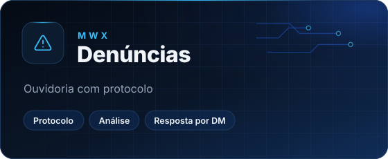</a>

Denúncias organizadas, com prova, análise da staff e resposta ao denunciante.

<ul>
<li>Painel com Denunciar e Acompanhar</li>
<li>Protocolo para cada denúncia (DEN-0001)</li>
<li>Card de análise com Aceitar ou Negar</li>
<li>Canais separados para aceitas e negadas</li>
<li>Decisão enviada por DM e limite contra spam</li>
</ul>

<b>Para a organização:</b> toda denúncia tem número, registro e resposta.

<a href="docs/bots/denuncias.md"><b>Ver documentação →</b></a>

</td>
</tr>
</table>

 

## Módulos adicionais

Soluções que se somam ao MWX Management, **disponíveis sob orçamento**.

<table>
<tr>
<td width="50%" valign="top">&nbsp;<b>Controle de Efetivo</b> &nbsp;Quem entrou, quem recrutou, quem saiu e por quê, com pendências para a liderança conferir.</td>
<td width="50%" valign="top">&nbsp;<b>Confirmação de Presença</b> &nbsp;Confirmação por DM com formulário e resumo de confirmados, desistentes e sem resposta.</td>
</tr>
<tr>
<td valign="top">&nbsp;<b>DM em Massa</b> &nbsp;Mensagens para um cargo inteiro, com prévia e relatório de DMs fechadas.</td>
<td valign="top">&nbsp;<b>Promoção e Rebaixamento</b> &nbsp;Troca de cargo com aviso por DM e registro em log.</td>
</tr>
<tr>
<td valign="top">&nbsp;<b>Desligamento de Membros</b> &nbsp;Remove cargos, registra o motivo e avisa o membro.</td>
<td valign="top">&nbsp;<b>Blacklist</b> &nbsp;Pessoas barradas por ID do jogo, consultadas no recrutamento.</td>
</tr>
</table>

<a href="docs/bots/extras.md">Detalhes dos módulos</a> · <a href="#contato">Solicitar orçamento</a>

 

## Demonstrações

<table>
<tr>
<td width="50%" valign="top">
<b>MWX Atendimento · Painel</b>  
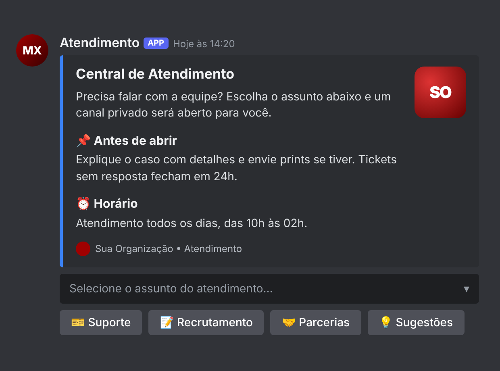 
O membro escolhe o assunto e recebe um canal privado, já com a equipe certa.
</td>
<td width="50%" valign="top">
<b>MWX Atendimento · Recrutamento</b>  
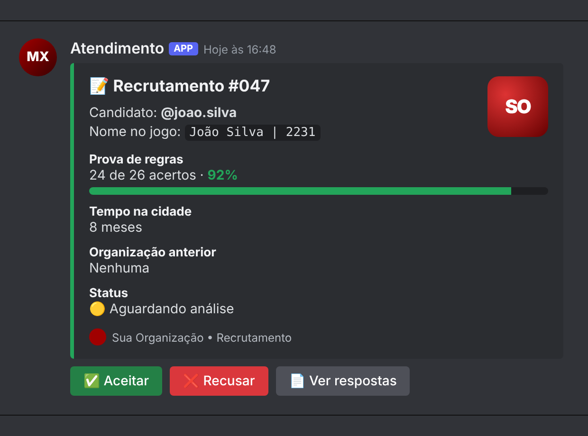 
A staff vê respostas e nota da prova antes de decidir, com um clique para aceitar ou recusar.
</td>
</tr>
<tr>
<td valign="top">
<b>MWX Bate-Ponto</b>  
 
Expediente em três botões e ranking de horas sempre à vista.
</td>
<td valign="top">
<b>MWX Farm</b>  
 
Cada registro chega com prova e progresso da meta para a equipe conferir.
</td>
</tr>
<tr>
<td valign="top">
<b>MWX Encomendas</b>  
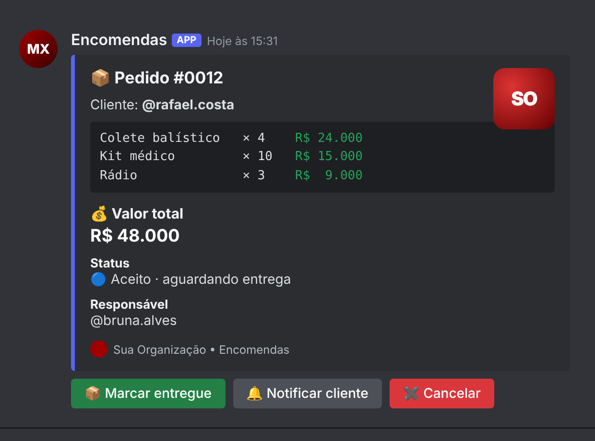 
Itens, valor total, status e responsável do pedido em um só lugar.
</td>
<td valign="top">
<b>MWX Management</b>  
 
Filtro automático e advertências registrados com punição e histórico.
</td>
</tr>
<tr>
<td colspan="2" valign="top">
<b>MWX Denúncias</b>  
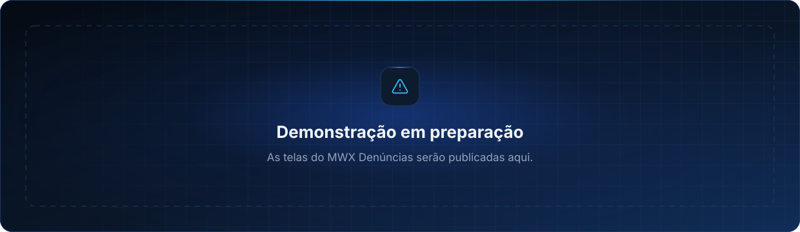
</td>
</tr>
</table>

Imagens ilustrativas das interfaces, com dados fictícios. Cores, nome e ícone mudam conforme o servidor.

<!-- GIFs: salve em assets/telas/gifs/<sistema>.gif e troque a imagem do card correspondente. Veja assets/telas/gifs/README.md. -->

 

## Diferenciais

<table>
<tr>
<td width="50%" valign="top">&nbsp;<b>Feito em português</b> &nbsp;Textos pensados para o RP brasileiro: cidadão, recrutamento, farm, expediente.</td>
<td width="50%" valign="top">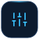&nbsp;<b>Configurado pelo Discord</b> &nbsp;Canais, cargos e categorias escolhidos por comandos. Nada fica fixo no código.</td>
</tr>
<tr>
<td valign="top">&nbsp;<b>A cara do seu servidor</b> &nbsp;Cores, nome da organização, banner e painéis com a sua identidade.</td>
<td valign="top">&nbsp;<b>Sistemas integrados</b> &nbsp;O registro do Management alimenta o Atendimento e o Farm. As Encomendas entram no painel de atendimento.</td>
</tr>
<tr>
<td valign="top">&nbsp;<b>Tudo registrado</b> &nbsp;Moderação, mensagens, entradas, tickets e expediente ficam em canais de log.</td>
<td valign="top">&nbsp;<b>Relatórios prontos</b> &nbsp;Horas e farm do mês saem em planilha .xlsx, prontas para a liderança.</td>
</tr>
<tr>
<td valign="top">&nbsp;<b>Modular</b> &nbsp;Contrate só o que precisa. Cada sistema funciona sozinho e se conecta aos outros.</td>
<td valign="top">&nbsp;<b>Suporte</b> &nbsp;Ajustes e atualizações durante o período do plano contratado.</td>
</tr>
</table>

 

## Planos

<table>
<tr>
<td width="33%" valign="top">
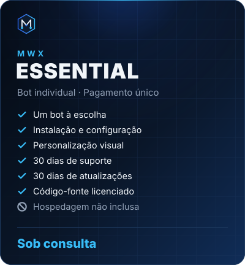
<ul>
<li>Um bot à escolha</li>
<li>Instalação e configuração</li>
<li>Personalização visual</li>
<li>30 dias de suporte</li>
<li>30 dias de atualizações</li>
<li>Código-fonte com licença de uso</li>
<li>Hospedagem não inclusa</li>
</ul>
</td>
<td width="34%" valign="top">

<ul>
<li><b>Os seis sistemas</b></li>
<li>Instalação e configuração</li>
<li>Personalização visual</li>
<li>90 dias de suporte</li>
<li>90 dias de atualizações</li>
<li>Código-fonte com licença de uso</li>
<li>Hospedagem não inclusa</li>
</ul>
</td>
<td width="33%" valign="top">

<ul>
<li>Bots à escolha</li>
<li>Instalação e configuração</li>
<li>Personalização visual</li>
<li><b>Hospedagem 24/7</b></li>
<li>Suporte enquanto ativa</li>
<li>Atualizações enquanto ativa</li>
<li>Sem entrega do código-fonte</li>
</ul>
</td>
</tr>
<tr>
<td colspan="3">

Precisa de uma função nova, de um módulo adicional ou de um visual exclusivo? O <b>MWX Custom</b> é desenvolvido sob medida para a sua organização, com orçamento individual.

</td>
</tr>
</table>

<a href="docs/planos.md">Comparativo completo dos planos</a> · <a href="#contato">Solicitar orçamento</a>

 

## Como contratar

<table>
<tr>
<td width="50%" valign="top">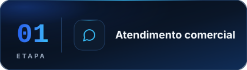 Você conta como é a sua organização e o que ela precisa.</td>
<td width="50%" valign="top"> Definimos juntos os sistemas e o plano.</td>
</tr>
<tr>
<td valign="top"> Os sistemas entram no seu servidor com canais, cargos, cores e textos ajustados.</td>
<td valign="top">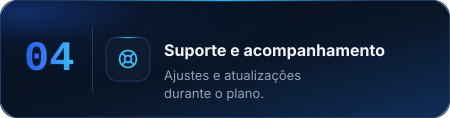 Ajustes e atualizações durante o período do plano.</td>
</tr>
</table>

 

## Documentação

| Página | Conteúdo |
|---|---|
| [MWX Management](docs/bots/management.md) | Moderação, filtros, registro, ausências e estrutura |
| [MWX Atendimento](docs/bots/atendimento.md) | Tickets, transcripts e recrutamento |
| [MWX Bate-Ponto](docs/bots/ponto.md) | Expediente, ranking, relatórios e planilha |
| [MWX Farm](docs/bots/farm.md) | Registro, análise, metas e TOP do mês |
| [MWX Encomendas](docs/bots/encomendas.md) | Catálogo, pedidos e entrega |
| [MWX Denúncias](docs/bots/denuncias.md) | Protocolo, análise e resposta |
| [Módulos adicionais](docs/bots/extras.md) | Soluções sob orçamento |
| [Comandos](docs/comandos.md) | Todos os comandos em um só lugar |
| [Requisitos e instalação](docs/instalacao.md) | O que é preciso para colocar no ar |
| [Planos](docs/planos.md) | Comparativo comercial |
| [Perguntas frequentes](docs/faq.md) | Dúvidas técnicas e comerciais |

 

## Perguntas frequentes

<b>Funciona em qualquer servidor de RP?</b>

 
Sim. Facção, polícia, hospital, mecânica ou empresa. Os textos, canais e cargos são configuráveis.

<b>Onde os bots ficam hospedados?</b>

 
Nos planos Essential e Complete, em um PC ligado 24h, uma VPS ou um painel de hospedagem de bots, à sua escolha. No MWX Cloud a hospedagem 24/7 já está inclusa.

<b>Como é feita a instalação?</b>

 
Instalação e configuração fazem parte de todos os planos. Os requisitos técnicos estão em <a href="docs/instalacao.md">Requisitos e instalação</a>.

<b>Posso mudar cores, nome e ícone?</b>

 
Sim. Os painéis usam o nome, as cores e o banner da sua organização.

<b>Como funciona a licença?</b>

 
Nos planos Essential e Complete você recebe o código-fonte com licença de uso no seu servidor. Revenda, redistribuição e publicação do código não são permitidas. No MWX Cloud o código não é entregue.

<b>Por quanto tempo tenho suporte?</b>

 
30 dias no Essential, 90 dias no Complete e enquanto a assinatura estiver ativa no Cloud.

<b>E as atualizações?</b>

 
Seguem o mesmo período do suporte de cada plano.

<b>Preciso saber programar?</b>

 
Não. Tudo é configurado por comandos no próprio Discord, e a instalação é feita por nós.

<a href="docs/faq.md">Mais perguntas, incluindo as técnicas</a>

 

## Contato

<table>
<tr>
<td width="33%" align="center" valign="top"> <b>Comercial</b> Aquisição de bots, planos, assinaturas e orçamentos.</td>
<td width="34%" align="center" valign="top"> <b>Suporte técnico</b> Instalação, configurações, dúvidas e assistência.</td>
<td width="33%" align="center" valign="top"> <b>Projetos exclusivos</b> Desenvolvimento de sistemas personalizados.</td>
</tr>
</table>

<!-- Canais pendentes: quando houver os dados oficiais, descomente e preencha.

-->

Atendimento em português · Brasil

 

© 2026 MWX Systems. Todos os direitos reservados. Veja a <a href="LICENSE.md">licença</a>. Discord é marca da Discord Inc. A MWX Systems não é afiliada ao Discord.

