

<picture>
  <source media="(max-width: 600px)" srcset="assets/banners/banner-mobile.png">
  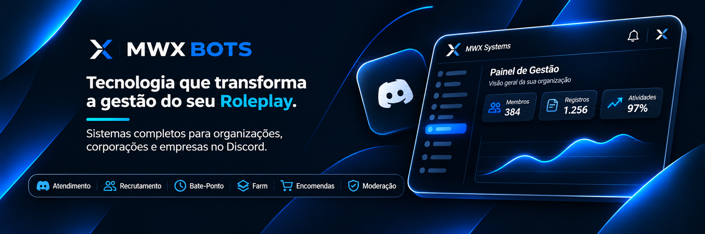
</picture>

 

### Tecnologia que transforma a gestão do seu Roleplay.

A **MWX Systems** desenvolve sistemas para organizações de GTA Roleplay no Discord. 
Atendimento, recrutamento, expediente, produção, vendas e moderação, em português e com a identidade do seu servidor.

 

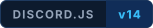&nbsp;
&nbsp;
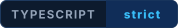&nbsp;
&nbsp;

  

<a href="#planos">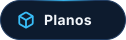</a>

 

> [!NOTE]
> Este repositório é a vitrine dos sistemas MWX. Os planos dão direito ao uso dos sistemas. O código-fonte não está incluso.

 

## Nossos sistemas

Seis sistemas independentes que trabalham juntos. Clique em um card para ver funções, comandos e requisitos.

<a href="docs/bots/management.md">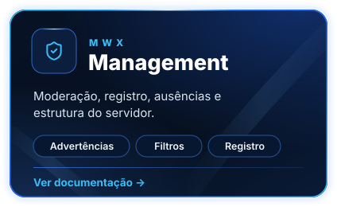</a>

<a href="docs/bots/farm.md">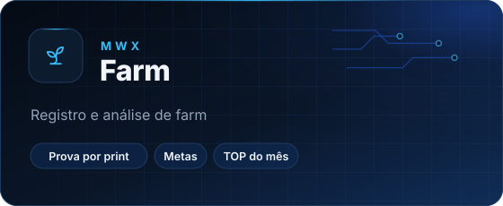</a>
<a href="docs/bots/encomendas.md">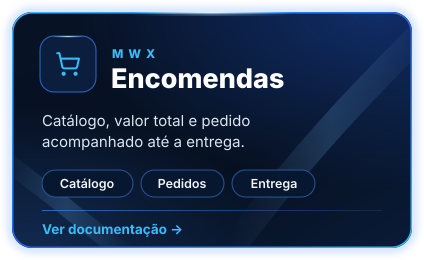</a>

 

## Módulos adicionais

Soluções que se somam ao MWX Management, **sob orçamento**. [Ver detalhes](docs/bots/extras.md)

<a href="docs/bots/extras.md">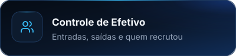</a>
<a href="docs/bots/extras.md">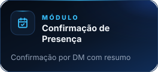</a>
<a href="docs/bots/extras.md">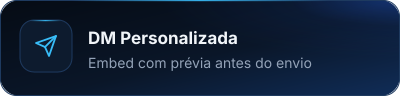</a>
<a href="docs/bots/extras.md">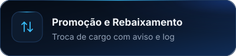</a>

 

## Demonstrações

Atendimento · Recrutamento · Bate-Ponto · Farm · Encomendas · Management · Denúncias

<a href="docs/bots/ponto.md">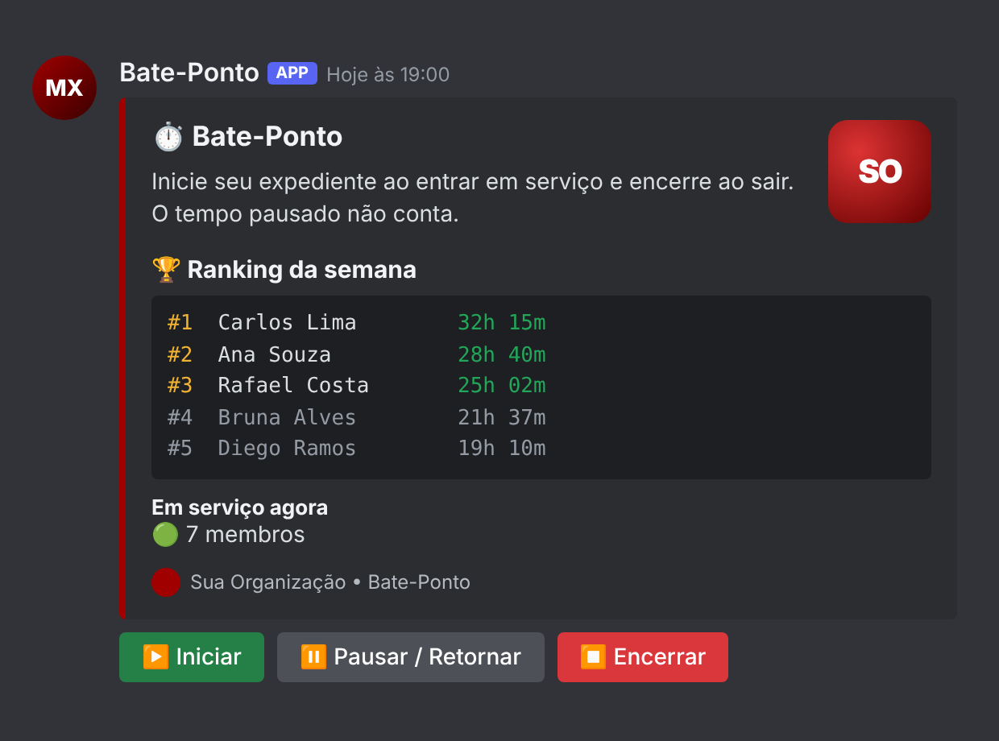</a>
<a href="docs/bots/farm.md">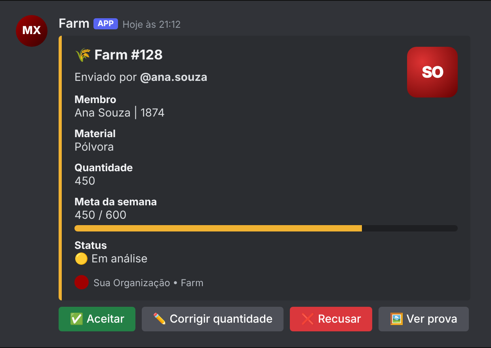</a>

Imagens ilustrativas das interfaces, com dados fictícios. Cores, nome e ícone mudam conforme o servidor.

<!-- GIFs: salve em assets/telas/gifs/<sistema>.gif e troque a imagem correspondente. Veja assets/telas/gifs/README.md. -->

 

## Diferenciais

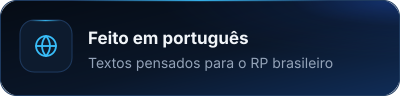
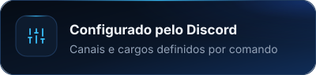
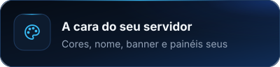

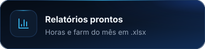
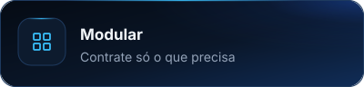
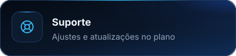

 

## Planos

Valores sob consulta. [Comparativo completo](docs/planos.md) · [Solicitar orçamento](#contato)

<a href="docs/planos.md">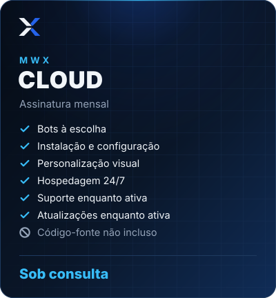</a>
<a href="docs/planos.md">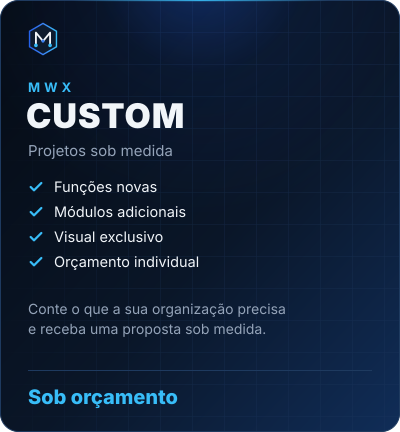</a>

> [!IMPORTANT]
> **Código-fonte não incluso nos planos.** Os planos dão direito ao uso dos sistemas. A aquisição do código-fonte só acontece após negociação com o setor responsável da MWX. [Falar com a MWX](#contato)

 

## Como contratar

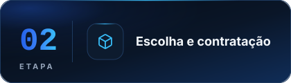
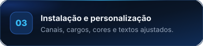

 

## Documentação

**Sistemas:** [Management](docs/bots/management.md) · [Atendimento](docs/bots/atendimento.md) · [Bate-Ponto](docs/bots/ponto.md) · [Farm](docs/bots/farm.md) · [Encomendas](docs/bots/encomendas.md) · [Denúncias](docs/bots/denuncias.md) · [Módulos adicionais](docs/bots/extras.md)

**Guias:** [Comandos](docs/comandos.md) · [Requisitos e instalação](docs/instalacao.md) · [Planos](docs/planos.md) · [Perguntas frequentes](docs/faq.md)

 

<picture>
  <source media="(max-width: 600px)" srcset="assets/branding/faq-topo-mobile.svg">
  
</picture>

## Perguntas frequentes

<b>Funciona em qualquer servidor de RP?</b>

 
Sim. Facção, polícia, hospital, mecânica ou empresa. Textos, canais e cargos são configuráveis.

<b>Preciso saber programar?</b>

 
Não. A instalação e a configuração fazem parte dos planos, e os ajustes do dia a dia são feitos por comandos no Discord.

<b>Onde os bots ficam hospedados?</b>

 
No Essential e no Complete, em um PC ligado 24h, VPS ou painel de hospedagem de bots, à sua escolha. No Cloud a hospedagem 24/7 está inclusa.

<b>Posso personalizar a identidade dos bots?</b>

 
Sim. Os painéis usam o nome, as cores e o banner da sua organização.

<b>Como funciona a licença?</b>

 
Os planos dão direito ao uso dos sistemas no seu servidor e não incluem o código-fonte. A aquisição do código-fonte só acontece após negociação com o setor responsável da MWX. Revenda, redistribuição e publicação não são permitidas.

<b>Por quanto tempo tenho suporte?</b>

 
30 dias no Essential, 90 dias no Complete e enquanto a assinatura estiver ativa no Cloud. As atualizações seguem o mesmo prazo.

<a href="docs/faq.md">Mais perguntas, incluindo as técnicas</a>

 

## Contato

<picture>
  <source media="(max-width: 600px)" srcset="assets/branding/contato-mobile.svg">
  
</picture>

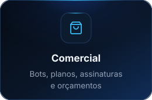
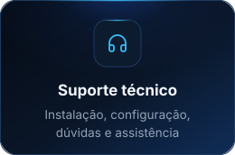
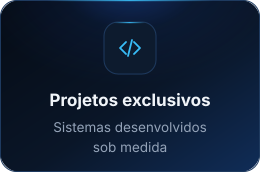

Discord: <b>niklausx_</b> · E-mail: <b>contato.mwxsystems@gmail.com</b> · Atendimento em português · Brasil

<!-- Canais pendentes: quando houver os dados oficiais, descomente e preencha.

-->

 

<picture>
  <source media="(max-width: 600px)" srcset="assets/branding/rodape-mobile.svg">
  
</picture>

© 2026 MWX Systems. Todos os direitos reservados. Veja a <a href="LICENSE.md">licença</a>. Discord é marca da Discord Inc. A MWX Systems não é afiliada ao Discord.

