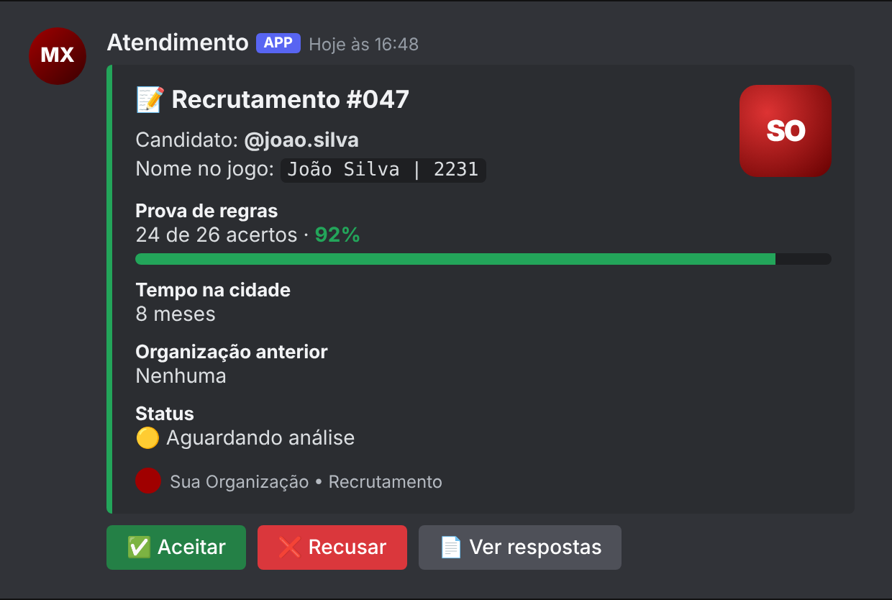

# 🎫 Atendimento · Tickets e recrutamento

Atendimento privado por assunto e um processo de recrutamento completo, do formulário à entrevista.

## Tickets

- Dois painéis: **público** (qualquer pessoa) e **interno** (só membros).
- Um tipo de ticket por categoria: suporte, denúncia, parceria, sugestão, compra e o que mais precisar.
- A equipe de cada tipo é definida pelos cargos que veem a categoria. Nada de lista fixa.
- Assumir, renomear, adicionar e remover pessoas, fechar.
- **Transcript HTML** de toda a conversa, enviado ao canal de transcripts, ao log e à DM do cliente com botão "Ver transcript".
- Assunto do ticket passa pelo filtro de palavrões (com o Management).
- Se salvar o transcript falhar, o ticket não é apagado.

## Recrutamento

- O candidato abre o recrutamento e recebe um canal temporário só dele.
- **Etapa 1:** perguntas abertas (ex.: tempo na cidade, organização anterior, idade).
- **Etapa 2:** prova de regras em múltipla escolha A–E, com gabarito.
- A staff recebe um card com as respostas e a **porcentagem de acertos**, com Aceitar ou Recusar com motivo.
- Aceito: DM, cargo "Aguardando entrevista" e ticket de entrevista aberto sozinho.
- Recusado: DM com o motivo.
- Perguntas editáveis num arquivo, sem reiniciar o bot. Canal expira se o candidato abandonar.

## Comandos

| Comando | Para quê |
|---|---|
| `/config-ticket` | Painel com toda a configuração (canais, cargos, categorias, cor, banner, enviar painéis) |
| `/config-recrutamento` | Categoria, canal de análise, cargos de espera, membro, recrutador e liderança |
| `/tickets-painel` | Publica o painel público |
| `/ticket-assumir` `/ticket-adicionar` `/ticket-remover` `/ticket-fechar` `/renomear` | Dentro do ticket |
| `/reiniciar-ticket` | Reinício pelo Discord (admin) |

## Requisitos

Node.js 20+. Sem banco de dados. Intent: Message Content.
