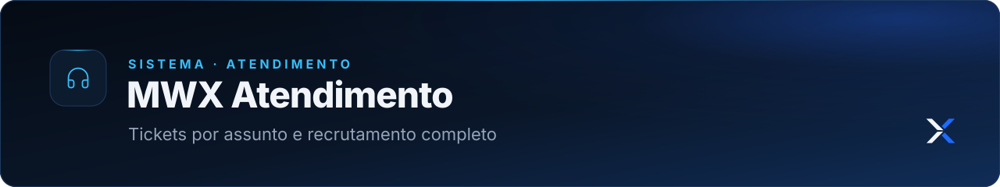
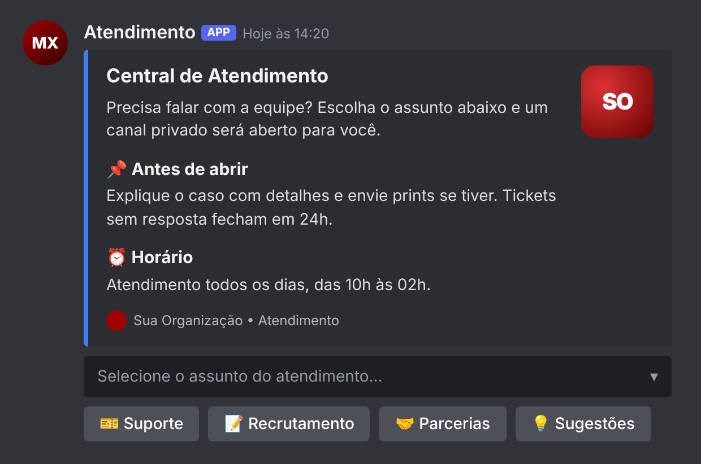

<picture>
  <source media="(max-width: 1103px)" srcset="../../assets/banners/doc-atendimento-mobile.svg">
  
</picture>

<a href="../../README.md#nossos-sistemas">Catálogo</a> · <a href="../../docs/comandos.md">Comandos</a> · <a href="../../docs/planos.md">Planos</a> · <a href="../../README.md#contato">Contato</a>

## Apresentação

O MWX Atendimento abre canais privados por assunto, registra toda a conversa e conduz o recrutamento do formulário à entrevista.

 

<picture></picture>

## Funcionalidades

### Tickets

- Dois painéis: público, para qualquer pessoa, e interno, só para membros
- Um tipo de ticket por categoria: suporte, denúncia, parceria, sugestão, compra e outros
- A equipe de cada tipo é definida pelos cargos que veem a categoria
- Assumir, renomear, adicionar e remover pessoas e fechar
- Assunto do ticket passa pelo filtro de palavrões (com o MWX Management)

### Transcripts

- Transcript HTML de toda a conversa ao fechar
- Enviado ao canal de transcripts, ao log e à DM do cliente com o botão Ver transcript
- Se o armazenamento falhar, o ticket não é apagado

### Recrutamento

- Canal temporário só do candidato
- Etapa 1: perguntas abertas, como tempo na cidade, organização anterior e idade
- Etapa 2: prova de regras em múltipla escolha A–E, com gabarito
- Card para a staff com as respostas e a porcentagem de acertos, com Aceitar ou Recusar com motivo
- Aceito: DM, cargo de espera e ticket de entrevista aberto sozinho
- Recusado: DM com o motivo
- Perguntas editáveis em arquivo, sem reiniciar o bot, e canal que expira se o candidato abandonar

## Benefícios

- Atendimento rápido e privado, sempre com a equipe certa
- Prova de cada conversa no transcript
- Recrutamento igual para todos os candidatos, com nota objetiva da prova
- Menos tarefas manuais da staff entre aprovação e entrevista

## Demonstrações

O membro escolhe o assunto e recebe um canal privado.

A staff decide com respostas e nota da prova à vista.

Imagens ilustrativas da interface, com dados fictícios.

 

<picture></picture>

## Comandos

| Comando | Para quê |
|---|---|
| `/config-ticket` | Configuração completa: canais, cargos, categorias, cor, banner e envio dos painéis |
| `/config-recrutamento` | Categoria, canal de análise e cargos de espera, membro, recrutador e liderança |
| `/tickets-painel` | Publica o painel público |
| `/ticket-assumir` `/ticket-adicionar` `/ticket-remover` | Dentro do ticket |
| `/renomear` `/ticket-fechar` | Renomear e fechar com transcript |
| `/reiniciar-ticket` | Reinício pelo Discord (admin) |

 

<picture></picture>

## Requisitos técnicos

- Node.js 20 ou mais novo
- Sem banco de dados: dados em arquivos JSON
- Intent privilegiado: Message Content
- Funciona em um servidor por instalação

## Integrações

- Com o [MWX Management](management.md): filtro de palavrões no assunto e nome/ID do registro no recrutamento
- Com o [MWX Encomendas](encomendas.md) no mesmo aplicativo: opção Encomendas dentro do painel de atendimento
- Com o MWX Encomendas instalado na mesma máquina: a atividade (status) do bot é lida do mesmo banco

 

<picture></picture>

<a href="../../README.md#nossos-sistemas"><b>← Voltar ao catálogo</b></a> · <a href="../../docs/planos.md">Conhecer os planos</a> · <a href="../../README.md#contato">Falar com a MWX</a>

© 2026 MWX Systems · Sua organização. Nossa tecnologia.

