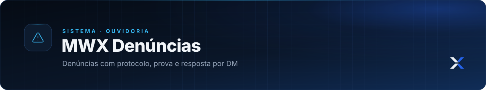
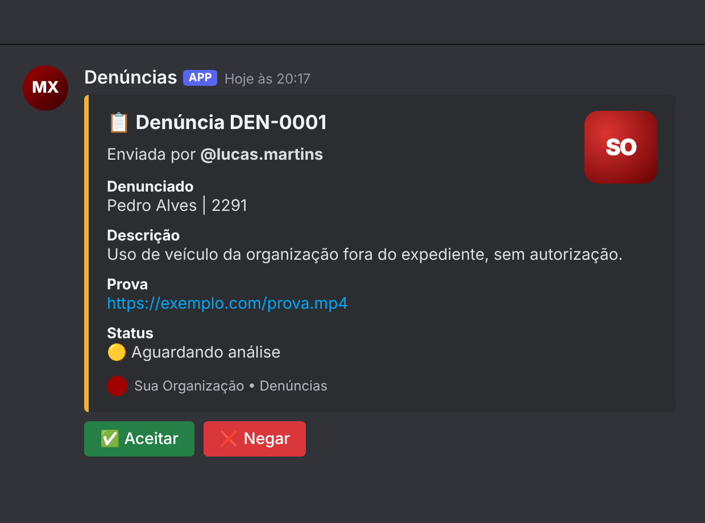
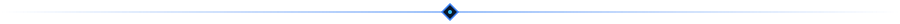

<a href="../../README.md#nossos-sistemas">Catálogo</a> · <a href="../../docs/comandos.md">Comandos</a> · <a href="../../docs/planos.md">Planos</a> · <a href="../../README.md#contato">Contato</a>

## Apresentação

O MWX Denúncias organiza denúncias com prova, análise da staff e resposta ao denunciante, sem depender de ticket aberto.

 

## Funcionalidades

### Envio

- Painel com Denunciar e Acompanhar
- Protocolo para cada denúncia (por exemplo DEN-0001)
- Prova por link na descrição

### Análise

- Card para a staff com Aceitar ou Negar
- Denúncias decididas vão para canais separados de aceitas e negadas

### Resposta e controle

- Decisão enviada ao denunciante por DM
- Limite de denúncias pendentes por pessoa e intervalo entre envios

## Benefícios

- Toda denúncia tem número e registro
- Staff analisa com prova à mão
- Denunciante recebe resposta sem precisar cobrar

## Demonstrações

Painel público com os botões Denunciar e Acompanhar.

Card da denúncia DEN-0001 com prova e botões Aceitar e Negar.

Imagens ilustrativas da interface, com dados fictícios.

 

## Comandos

O MWX Denúncias funciona pelos botões do painel (**Denunciar** e **Acompanhar**) e pelos cards da staff. Não há comandos para o membro decorar.

 

## Requisitos técnicos

- Node.js 20 ou mais novo
- Sem banco de dados: dados em arquivo JSON
- Intents privilegiados: a confirmar com a MWX

## Integrações

Funciona de forma independente.

 

<a href="../../README.md#nossos-sistemas"><b>← Voltar ao catálogo</b></a> · <a href="../../docs/planos.md">Conhecer os planos</a> · <a href="../../README.md#contato">Falar com a MWX</a>

© 2026 MWX Systems · Sua organização. Nossa tecnologia.

