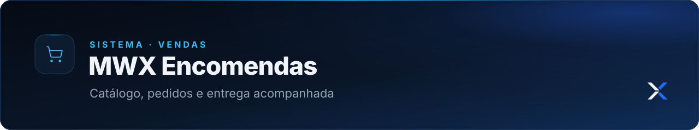
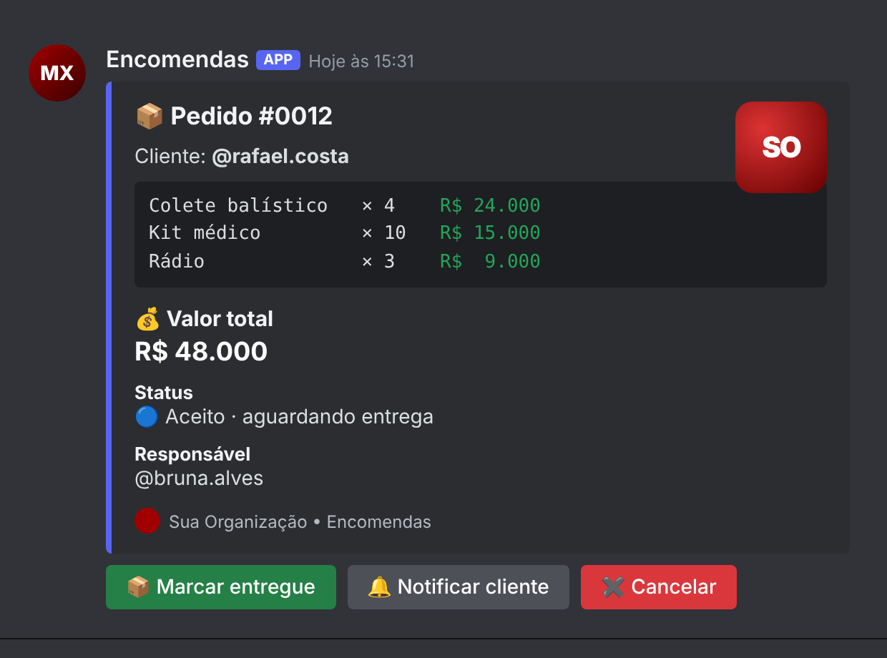

<a href="../../README.md#nossos-sistemas">Catálogo</a> · <a href="../../docs/comandos.md">Comandos</a> · <a href="../../docs/planos.md">Planos</a> · <a href="../../README.md#contato">Contato</a>

## Apresentação

O MWX Encomendas coloca a loja da organização dentro do Discord: o cliente escolhe, vê o total e a equipe acompanha até a entrega.

 

## Funcionalidades

### Pedido

- Painel fixo com o botão Realizar encomenda
- Catálogo com preço, menu de produtos e quantidades
- Resumo com valor total antes de confirmar
- Limite de quantidade por produto

### Atendimento do pedido

- Ticket do pedido aberto e numerado automaticamente
- Canal de pedidos para a equipe aceitar, negar e concluir a entrega
- Aviso ao cliente a cada etapa

### Catálogo

- Produtos adicionados, editados e removidos por comando

## Benefícios

- Valor certo em todo pedido, sem conta manual
- Cada pedido com número e responsável
- Cliente acompanha o andamento sem cobrar a equipe

## Demonstrações

Itens, valor total, status e responsável do pedido em um só lugar.

Imagens ilustrativas da interface, com dados fictícios.

 

## Comandos

| Comando | Para quê |
|---|---|
| `/config-encomenda` | Categoria, canal de pedidos, cargos, nome, cor e aparência do bot |
| `/produtos-encomenda adicionar\|editar\|remover\|listar\|padrao` | Catálogo |
| `/painel-encomenda` | Publica o painel |
| `/reiniciar-encomenda` | Reinício pelo Discord (admin) |

 

## Requisitos técnicos

- Node.js 20 ou mais novo
- PostgreSQL
- Sem intents privilegiados

## Integrações

- Com o [MWX Atendimento](atendimento.md) no mesmo aplicativo: aparece como opção no painel de atendimento

 

<a href="../../README.md#nossos-sistemas"><b>← Voltar ao catálogo</b></a> · <a href="../../docs/planos.md">Conhecer os planos</a> · <a href="../../README.md#contato">Falar com a MWX</a>

© 2026 MWX Systems · Sua organização. Nossa tecnologia.

