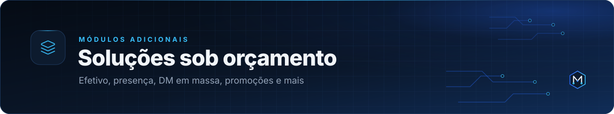

<picture>
  <source media="(max-width: 1103px)" srcset="../../assets/banners/doc-extras-mobile.svg">
  
</picture>

<a href="../../README.md#nossos-sistemas">Catálogo</a> · <a href="../../docs/comandos.md">Comandos</a> · <a href="../../docs/planos.md">Planos</a> · <a href="../../README.md#contato">Contato</a>

## Apresentação

Funções já em uso no MWX Management que podem ser somadas ao [MWX Management](management.md). Os módulos **não fazem parte dos planos de assinatura nem dos sistemas individuais**: cada um é **orçado à parte** pelo MWX Custom ([outras modalidades](../planos.md#outras-modalidades)). Eles funcionam dentro do MWX Management, não como bots independentes.

 

## Módulos

###  Controle de Efetivo

Registra quem entrou, quem recrutou, quem saiu e por quê (saída, expulsão ou banimento), com pendências para a liderança conferir.

Comandos: `/efetivo` `/membro` `/saidas` `/pendencias` `/registrar-saida` `/registrar-retorno`

###  Confirmação de Presença

Envia por DM a cada membro uma confirmação (Vou continuar ou Não vou continuar) com formulário. A liderança vê o resumo de confirmados, desistentes e sem resposta.

Comandos: `/presenca enviar` `/presenca resumo`

###  DM Personalizada

Mensagem em embed para um membro, com cor e imagem, prévia antes do envio e aviso quando a DM está fechada.

Comandos: `/dm enviar`

###  Promoção e Rebaixamento

Troca de cargo com aviso por DM e registro em log.

Comandos: `/promover` `/rebaixar`

###  Desligamento de Membros

Envia DM de agradecimento com o motivo, remove os cargos da organização e devolve o cargo de cidadão.

Comandos: `/desligamento`

###  Blacklist

Lista de pessoas barradas por ID do jogo, consultada no recrutamento e no registro.

Comandos: `/blacklist adicionar\|remover\|ver\|lista`

## Benefícios

- O Management cresce junto com a organização, sem trocar de sistema
- Cada módulo resolve uma rotina que hoje é feita à mão pela liderança

## Requisitos técnicos

- Requer o [MWX Management](management.md) instalado

 

<a href="../../README.md#nossos-sistemas"><b>← Voltar ao catálogo</b></a> · <a href="../../docs/planos.md">Conhecer os planos</a> · <a href="../../README.md#contato">Falar com a MWX</a>

© 2026 MWX Systems · Sua organização. Nossa tecnologia.

