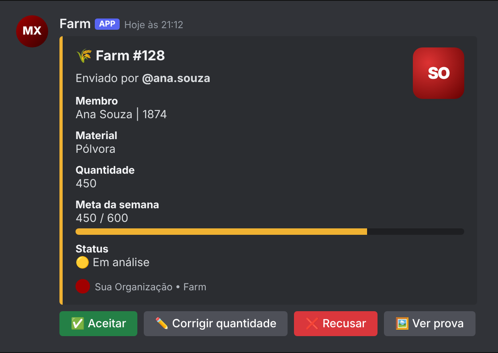

<picture>
  <source media="(max-width: 1103px)" srcset="../../assets/banners/doc-farm-mobile.svg">
  
</picture>

<a href="../../README.md#nossos-sistemas">Catálogo</a> · <a href="../../docs/comandos.md">Comandos</a> · <a href="../../docs/planos.md">Planos</a> · <a href="../../README.md#contato">Contato</a>

## Apresentação

O MWX Farm acaba com as planilhas manuais: o membro registra com prova, a equipe confere e o ranking sai sozinho.

 

## Funcionalidades

### Estrutura

- `/farm-setup` cria a categoria do farm com avisos, painel, registros e log, já com as permissões
- Materiais em menu (por exemplo Pólvora, Cobre, Plástico)

### Registro e análise

- Registro de material, quantidade e print pelo painel
- Equipe aceita, recusa ou corrige a quantidade
- Membro recebe DM com o resultado
- Consulta dos próprios registros pelo membro

### Metas e ranking

- Metas semanais com cargo de meta concluída e reset automático
- TOP do mês publicado na virada, com pódio
- Planilha .xlsx com registros, totais por jogador e ranking

## Benefícios

- Produção comprovada por print e conferida pela equipe
- Metas acompanhadas sem conta manual
- Reconhecimento mensal automático dos que mais produzem

## Demonstrações

Cada registro chega com prova e progresso da meta para a equipe conferir.

Imagens ilustrativas da interface, com dados fictícios.

 

## Comandos

| Comando | Para quê |
|---|---|
| `/farm-setup` | Cria ou atualiza canais, permissões e painel |
| `/config-farm ver\|canais\|analisadores\|membros\|lideranca\|categoria-logs\|materiais\|top\|reenviar-painel` | Configuração |
| `/painelfarm` | Reenvia o painel |
| `/farm-planilha` | Planilha do mês |

 

## Requisitos técnicos

- Node.js 20 ou mais novo
- Sem banco de dados: dados em arquivo JSON
- Intent privilegiado: Server Members

## Integrações

- Com o [MWX Management](management.md): nome e ID preenchidos a partir do registro

 

<a href="../../README.md#nossos-sistemas"><b>← Voltar ao catálogo</b></a> · <a href="../../docs/planos.md">Conhecer os planos</a> · <a href="../../README.md#contato">Falar com a MWX</a>

© 2026 MWX Systems · Sua organização. Nossa tecnologia.

