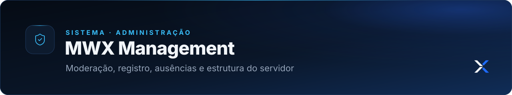
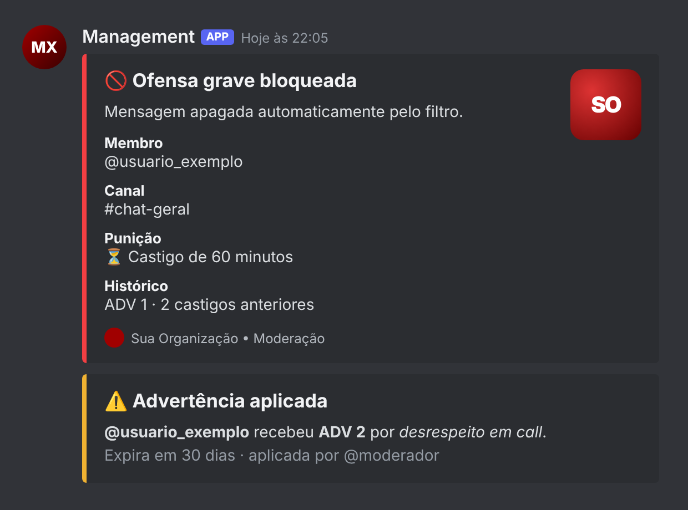

<picture>
  <source media="(max-width: 1103px)" srcset="../../assets/banners/doc-management-mobile.svg">
  
</picture>

<a href="../../README.md#nossos-sistemas">Catálogo</a> · <a href="../../docs/comandos.md">Comandos</a> · <a href="../../docs/planos.md">Planos</a> · <a href="../../README.md#contato">Contato</a>

## Apresentação

O MWX Management é o braço direito da liderança. Modera o chat, guarda o histórico de cada membro, organiza registros e ausências e monta a estrutura do servidor.

 

<picture></picture>

## Funcionalidades

### Moderação

- Advertências com cargos (ADV 1, ADV 2, ADV 3) e ação automática ao atingir o limite: castigo, expulsão ou banimento
- Advertências que expiram depois de um prazo configurável
- Castigo, expulsão, banimento e desbanimento com motivo e log
- Limpar mensagens, trancar canal e modo lento

### Filtros automáticos

- Bloqueio de convites de outros servidores, links e palavrões, com castigo após repetição
- Filtro de ofensas graves (racismo, homofobia e similares) que vale também para a staff, com castigo imediato
- Detecção de disfarces, como letras separadas ou trocadas, sem bloquear palavras inocentes
- Filtro de nomes e apelidos proibidos
- Anti-flood

### Registro de membros

- Painel de registro com nome, sobrenome e ID do jogo
- Apelido automático no formato `Nome Sobrenome | ID`
- Liberação automática ou aprovação pela staff, com cargo dado e cargo removido
- Busca de membro por ID

### Ausências

- Painel para pedir ausência com motivo e período
- Aprovação por cargo responsável, cargo de ausente e encerramento automático na data marcada

### Comunicação

- `/anuncio` com janela de texto e prévia antes de publicar
- Painel de booster
- Boas-vindas, despedidas e cargo automático na entrada

### Estrutura e logs

- `/setup-servidor` monta cargos, categorias e canais a partir de um modelo, com prévia e confirmação, sem duplicar o que já existe
- Logs de moderação, mensagens apagadas e editadas, entradas e saídas e auto-moderação

## Benefícios

- Histórico de cada membro em um só lugar, consultável pela staff
- Menos trabalho manual: filtros e punições automáticas seguem as regras definidas
- Registro padronizado facilita encontrar qualquer membro pelo ID do jogo
- Servidor organizado desde o primeiro dia com a estrutura pronta

## Demonstrações

Filtro automático e advertência registrados com punição e histórico do membro.

Imagens ilustrativas da interface, com dados fictícios.

 

<picture></picture>

## Comandos

| Comando | Para quê |
|---|---|
| `/advertir` `/advertencias` `/remover-advertencia` | Advertências |
| `/castigo` `/remover-castigo` | Castigo por tempo |
| `/expulsar` `/banir` `/desbanir` | Expulsão e banimento com log |
| `/limpar` `/cargo adicionar\|remover` `/apelido` | Administração |
| `/trancar` `/destrancar` `/modo-lento` | Controle de canal |
| `/anuncio` `/painel-booster` | Comunicação |
| `/usuario-info` `/servidor-info` | Informações |
| `/registro painel\|config\|ver-config\|consultar\|buscar-id\|resetar` | Registro de membros |
| `/ausencia solicitar\|status\|painel\|lista\|encerrar` | Ausências |
| `/filtro palavra\|site\|ignorar` | Listas dos filtros |
| `/config-management` `/setup-servidor` `/ajuda-management` | Configuração e ajuda |

 

<picture></picture>

## Requisitos técnicos

- Node.js 20 ou mais novo
- Sem banco de dados: dados em arquivo JSON
- Intents privilegiados: Server Members e Message Content

## Integrações

- Fornece nome e ID do registro para o [MWX Atendimento](atendimento.md) e o [MWX Farm](farm.md), e a lista de palavrões para o assunto dos tickets do Atendimento
- Base dos [módulos adicionais](extras.md)

 

<picture></picture>

<a href="../../README.md#nossos-sistemas"><b>← Voltar ao catálogo</b></a> · <a href="../../docs/planos.md">Conhecer os planos</a> · <a href="../../README.md#contato">Falar com a MWX</a>

© 2026 MWX Systems · Sua organização. Nossa tecnologia.

