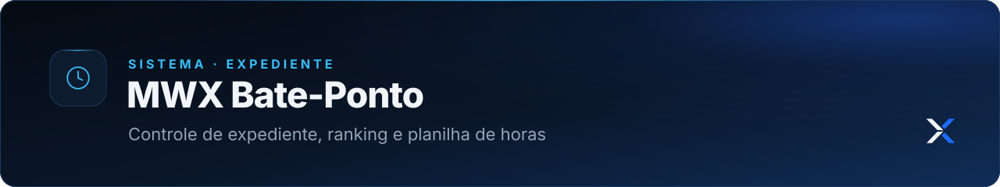
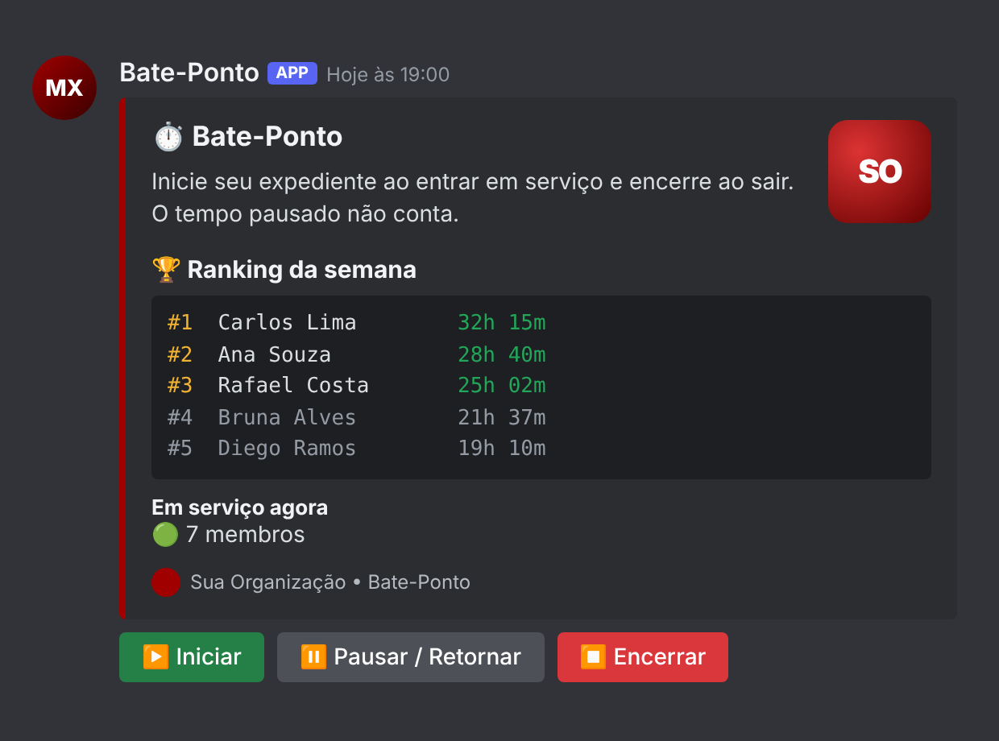

<picture>
  <source media="(max-width: 1103px)" srcset="../../assets/banners/doc-ponto-mobile.svg">
  
</picture>

<a href="../../README.md#nossos-sistemas">Catálogo</a> · <a href="../../docs/comandos.md">Comandos</a> · <a href="../../docs/planos.md">Planos</a> · <a href="../../README.md#contato">Contato</a>

## Apresentação

O MWX Bate-Ponto controla o expediente de polícia, hospital, mecânica, facção ou empresa: quem está em serviço, por quanto tempo e quem mais trabalhou.

 

## Funcionalidades

### Expediente

- Painel fixo com Iniciar, Pausar / Retornar e Encerrar
- Cargo em serviço dado e retirado automaticamente
- Calls de expediente opcionais, ligadas a uma categoria de voz
- Tempo com o bot fora do ar não conta: o expediente é pausado e o membro é avisado

### Acompanhamento

- Log em tempo real de cada início, pausa e fim
- Revisão de pontos pelo cargo revisor
- Reset por período, com confirmação

### Relatórios

- Ranking de horas (TOP 10) por semana, mês ou período
- Consulta de horas por membro com planilha .xlsx
- Relatórios e histórico

### Operação

- Vários servidores no mesmo bot

## Benefícios

- A liderança vê na hora quem está em serviço
- Horas calculadas sem planilha manual
- Ranking que reconhece quem mais trabalha
- Dados prontos para promoções e cobranças de meta

## Demonstrações

Expediente em três botões e ranking de horas sempre à vista.

Imagens ilustrativas da interface, com dados fictícios.

 

## Comandos

| Comando | Para quê |
|---|---|
| `/config-ponto` | Cargo em serviço, logs, admin, revisor, nome, banner e cor |
| `/painel-ponto` | Publica o painel com os botões |
| `/horas-ponto` | Horas por membro e período, com planilha |
| `/ranking-ponto` `/relatorio-ponto` `/historico-ponto` | Consultas |
| `/resetar-ponto` | Zera um período, com confirmação |
| `/reiniciar-ponto` | Reinício pelo Discord (admin) |

 

## Requisitos técnicos

- Node.js 20 ou mais novo
- PostgreSQL (pode ser o mesmo banco do MWX Encomendas)
- Sem intents privilegiados

## Integrações

Funciona de forma independente.

 

<a href="../../README.md#nossos-sistemas"><b>← Voltar ao catálogo</b></a> · <a href="../../docs/planos.md">Conhecer os planos</a> · <a href="../../README.md#contato">Falar com a MWX</a>

© 2026 MWX Systems · Sua organização. Nossa tecnologia.

