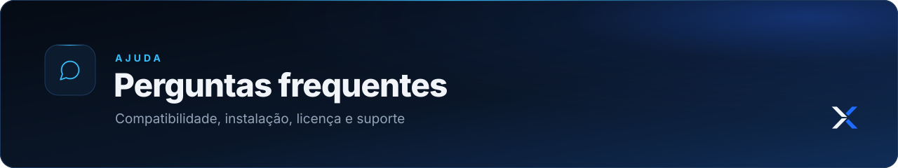

<a href="../README.md#nossos-sistemas">Catálogo</a> · <a href="../docs/comandos.md">Comandos</a> · <a href="../docs/planos.md">Planos</a> · <a href="../README.md#contato">Contato</a>

As perguntas comerciais principais também estão no [README](../README.md#perguntas-frequentes).

## Comercial

<b>Funciona em qualquer servidor de RP?</b>

 
Os sistemas foram feitos para organizações de RP no Discord, como facção, polícia, hospital, mecânica ou empresa. Textos, canais e cargos são configuráveis. Para um caso específico, confirme no atendimento comercial.

<b>Preciso saber programar?</b>

 
Não. Tudo é configurado por comandos no Discord, e a instalação faz parte dos planos.

<b>Posso revender os bots?</b>

 
Não. A licença é de uso no seu servidor. Revenda e redistribuição não são permitidas.

<b>O que o pagamento único inclui?</b>

 
O direito de uso dos sistemas contratados, com instalação, configuração, personalização visual e o período de suporte e atualizações do plano. Não inclui hospedagem nem código-fonte. O prazo e as demais condições do direito de uso são confirmados no atendimento comercial.

<b>O código-fonte vem junto?</b>

 
Não. Os planos não incluem o código-fonte. A aquisição só acontece após negociação com o setor responsável da MWX, pelo Discord ou pelo e-mail contato.mwxsystems@gmail.com.

<b>E se o Discord mudar algo?</b>

 
As atualizações estão inclusas durante o período do plano: 30 dias no Essential, 90 dias no Complete e enquanto ativa no Cloud.

## Técnico

<b>Quais sistemas precisam de banco de dados?</b>

 
Só o MWX Bate-Ponto e o MWX Encomendas, que usam PostgreSQL e podem dividir o mesmo banco. Os demais guardam os dados em arquivos JSON.

<b>Quanto de memória cada bot usa?</b>

 
Os sistemas são hospedados em planos de 512 MB de RAM por bot. O consumo varia com o tamanho do servidor e o volume de uso, então a MWX indica a hospedagem adequada no atendimento.

<b>Um bot atende vários servidores?</b>

 
O MWX Bate-Ponto atende vários servidores no mesmo bot. O MWX Atendimento funciona em um servidor por instalação.

<b>Como faço backup?</b>

 
Copie a pasta <code>data/</code> dos bots sem banco e faça o backup do PostgreSQL.

<b>O token do bot fica no código?</b>

 
Não. O token fica só no arquivo <code>.env</code> da instalação, que nunca deve ser compartilhado.

 

<a href="../README.md#nossos-sistemas"><b>← Voltar ao catálogo</b></a> · <a href="../docs/planos.md">Conhecer os planos</a> · <a href="../README.md#contato">Falar com a MWX</a>

© 2026 MWX Systems · Sua organização. Nossa tecnologia.

