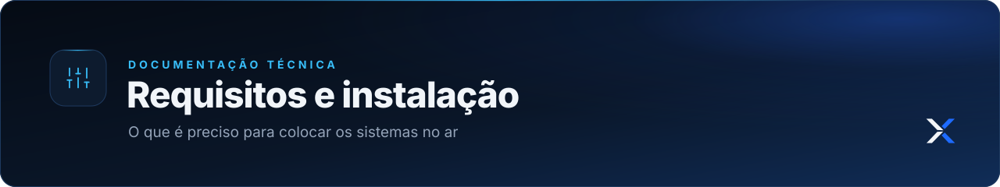

<a href="../README.md#nossos-sistemas">Catálogo</a> · <a href="../docs/comandos.md">Comandos</a> · <a href="../docs/planos.md">Planos</a> · <a href="../README.md#contato">Contato</a>

## Apresentação

Nos planos MWX a instalação e a configuração são feitas pela MWX. Esta página resume o que é preciso para os sistemas rodarem.

 

## Requisitos técnicos

| Item | Detalhe |
|---|---|
| Node.js | 20 ou mais novo |
| Banco de dados | PostgreSQL apenas para MWX Bate-Ponto e MWX Encomendas (os dois podem dividir o mesmo banco). Os demais usam arquivos JSON. |
| Hospedagem | PC ligado 24h, VPS ou painel de hospedagem de bots. Referência: a MWX usa planos de 512 MB de RAM por bot. Esse valor é a capacidade contratada, não um requisito mínimo medido; o consumo real varia com o servidor. No MWX Cloud a hospedagem está inclusa. |
| Discord | Um aplicativo no Discord Developer Portal para cada bot |

### Intents por sistema

| Sistema | Intents privilegiados |
|---|---|
| MWX Management | Server Members e Message Content |
| MWX Atendimento | Message Content |
| MWX Farm | Server Members |
| MWX Bate-Ponto | Nenhum |
| MWX Encomendas | Nenhum |
| MWX Denúncias | Nenhum obrigatório (Server Members opcional, para mostrar apelidos) |

## Instalação

1. Criar o aplicativo no Discord Developer Portal e ativar os intents do sistema.
2. Colocar o token no arquivo `.env`. Esse arquivo nunca deve ser compartilhado.
3. Instalar as dependências e iniciar o bot.
4. No Discord, rodar o comando `/config-…` do sistema e escolher canais e cargos.
5. Publicar os painéis.

Nos planos, esses passos são feitos pela MWX. Esta lista serve como referência técnica e não inclui a entrega do código-fonte.

## Integrações

- **MWX Atendimento + MWX Management:** filtro de palavrões no assunto do ticket e nome/ID do registro no recrutamento.
- **MWX Farm + MWX Management:** nome e ID preenchidos a partir do registro.
- **MWX Atendimento + MWX Encomendas:** opção Encomendas dentro do painel de atendimento (os dois no mesmo aplicativo).

## Segurança

- Nenhum ID de servidor, token ou senha fica no código.
- Backup simples: pasta `data/` dos bots sem banco e o banco PostgreSQL.

 

<a href="../README.md#nossos-sistemas"><b>← Voltar ao catálogo</b></a> · <a href="../docs/planos.md">Conhecer os planos</a> · <a href="../README.md#contato">Falar com a MWX</a>

© 2026 MWX Systems · Sua organização. Nossa tecnologia.

