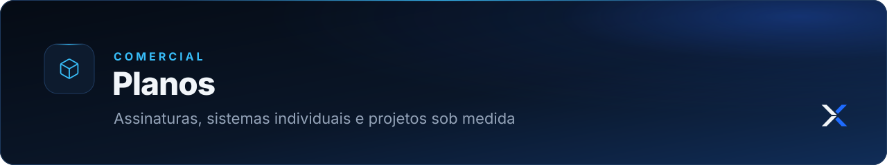

<picture>
  <source media="(max-width: 1103px)" srcset="../assets/banners/doc-planos-mobile.svg">
  
</picture>

<a href="../README.md#nossos-sistemas">Catálogo</a> · <a href="../docs/comandos.md">Comandos</a> · <a href="../docs/planos.md">Planos</a> · <a href="../README.md#contato">Contato</a>

Valores mensais por servidor. Hospedagem, suporte e atualizações inclusos nas assinaturas.

## Planos de assinatura

| Plano | Sistemas | Valor mensal | Economia |
|---|---|---|---|
| MWX Essential | Management · Atendimento / Ticket | R$ 49,90 | R$ 9,90/mês |
| MWX Operation | Management · Farm · Bate-Ponto | R$ 59,90 | R$ 29,80/mês |
| MWX Professional | Management · Atendimento / Ticket · Farm · Bate-Ponto | R$ 79,90 | R$ 34,70/mês |
| **MWX Complete** | Os seis sistemas | **R$ 99,90** | R$ 49,50/mês |

A economia é a diferença para a soma dos mesmos sistemas contratados individualmente.

## Sistemas individuais

Assinatura mensal por servidor.

| Sistema | Valor mensal |
|---|---|
| [MWX Management](bots/management.md) | R$ 34,90 |
| [MWX Atendimento / Ticket](bots/atendimento.md) | R$ 24,90 |
| [MWX Encomendas](bots/encomendas.md) | R$ 19,90 |
| [MWX Farm](bots/farm.md) | R$ 24,90 |
| [MWX Bate-Ponto](bots/ponto.md) | R$ 29,90 |
| [MWX Denúncias](bots/denuncias.md) | R$ 14,90 |

## Outras modalidades

- **Licença em pagamento único:** valor sob consulta. Direito de uso por tempo indeterminado, conforme as condições comerciais e contratuais da MWX Systems. Hospedagem não inclusa.
- **MWX Custom:** projetos personalizados, com funcionalidades sob medida e [módulos adicionais](bots/extras.md). Orçamento individual e condições definidas em cada projeto.

## Licença

Nas assinaturas, o direito de uso vale enquanto a assinatura estiver ativa. Na licença em pagamento único, o direito de uso é por tempo indeterminado e não significa suporte, hospedagem ou atualizações vitalícios. Em nenhum caso há aquisição da propriedade intelectual, o código-fonte não está incluso e revenda ou redistribuição não são permitidas. A aquisição do código-fonte só acontece mediante negociação comercial separada com a MWX Systems, inclusive em projetos Custom ([contato](../README.md#contato)). Veja a [licença](../LICENSE.md).

 

<a href="../README.md#nossos-sistemas"><b>← Voltar ao catálogo</b></a> · <a href="../docs/planos.md">Conhecer os planos</a> · <a href="../README.md#contato">Falar com a MWX</a>

© 2026 MWX Systems · Sua organização. Nossa tecnologia.

