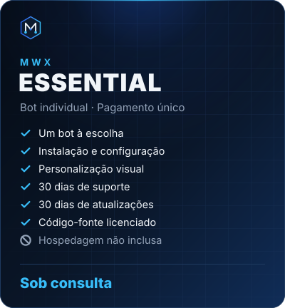
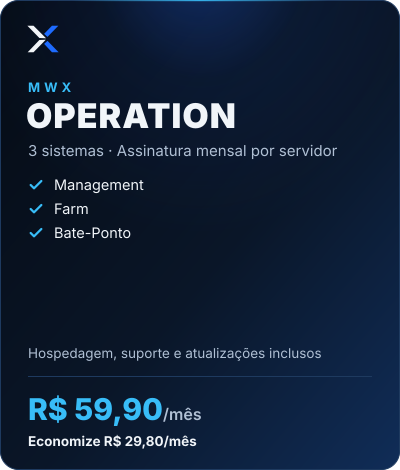
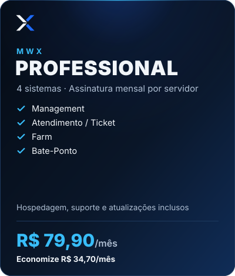
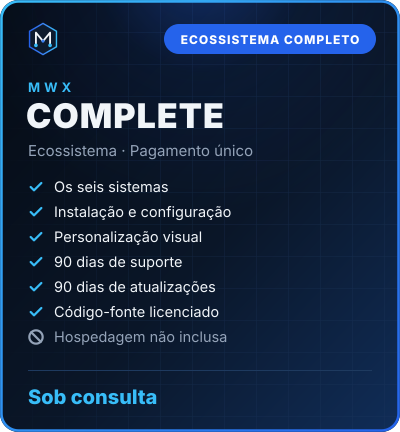
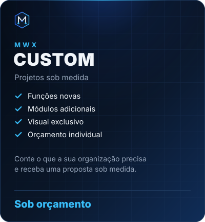

<picture>
  <source media="(max-width: 1103px)" srcset="../assets/banners/doc-planos-mobile.svg">
  
</picture>

<a href="../README.md#nossos-sistemas">Catálogo</a> · <a href="../docs/comandos.md">Comandos</a> · <a href="../docs/planos.md">Planos</a> · <a href="../README.md#contato">Contato</a>

Valores mensais por servidor. Hospedagem, suporte e atualizações inclusos nas assinaturas.

## Planos de assinatura

| Plano | Sistemas | Valor mensal | Economia |
|---|---|---|---|
| MWX Essential | Management · Atendimento / Ticket | R$ 49,90 | R$ 9,90/mês |
| MWX Operation | Management · Farm · Bate-Ponto | R$ 59,90 | R$ 29,80/mês |
| MWX Professional | Management · Atendimento / Ticket · Farm · Bate-Ponto | R$ 79,90 | R$ 34,70/mês |
| **MWX Complete** | Os seis sistemas | **R$ 99,90** | R$ 49,50/mês |

A economia é a diferença para a soma dos mesmos sistemas contratados individualmente.

### Qual plano escolher

- **MWX Essential:** para organizações que precisam estruturar a administração do servidor (registro, moderação, advertências e ausências) e o atendimento por tickets, com recrutamento.
- **MWX Operation:** para organizações que precisam acompanhar o expediente e o farm dos membros, com metas e ranking, além da administração do servidor.
- **MWX Professional:** para organizações que precisam integrar administração, atendimento e acompanhamento de expediente e farm.
- **MWX Complete:** para organizações que querem todo o ecossistema, incluindo vendas por encomenda e denúncias com protocolo.

## Sistemas individuais

Assinatura mensal por servidor.

| Sistema | Valor mensal |
|---|---|
| [MWX Management](bots/management.md) | R$ 34,90 |
| [MWX Atendimento / Ticket](bots/atendimento.md) | R$ 24,90 |
| [MWX Encomendas](bots/encomendas.md) | R$ 19,90 |
| [MWX Farm](bots/farm.md) | R$ 24,90 |
| [MWX Bate-Ponto](bots/ponto.md) | R$ 29,90 |
| [MWX Denúncias](bots/denuncias.md) | R$ 14,90 |

## Outras modalidades

| Modalidade | O que é | Valor |
|---|---|---|
| **Licença em pagamento único** | Direito de uso dos sistemas contratados por tempo indeterminado, conforme as condições comerciais e contratuais da MWX Systems. Hospedagem não inclusa. | Sob consulta |
| **MWX Personalizado** | Você escolhe quais sistemas existentes quer contratar, numa composição que não corresponde a um dos planos. O atendimento comercial define a composição e o valor final. | Sob consulta |
| **MWX Custom** | Desenvolvimento de funcionalidades, [módulos adicionais](bots/extras.md) ou projetos sob medida. | Sob orçamento, conforme o escopo |
| **Aquisição do código-fonte** | Negociação comercial separada. Não está inclusa em assinaturas, licenças em pagamento único, no MWX Personalizado nem no MWX Custom. | Negociação separada |

### Como funciona a contratação personalizada

1. Escolha os sistemas de que precisa (ou descreva o projeto, no caso do MWX Custom).
2. Informe a sua necessidade ao atendimento comercial no [Discord da MWX](https://discord.gg/xbDNJy6mtC).
3. Receba uma proposta personalizada, com composição, valor e condições.
4. Aprove a contratação.
5. Receba os sistemas conforme as condições acordadas.

Não há desconto automático nem valor pré-definido para combinações personalizadas: tudo é definido na proposta.

## Como solicitar

Todos os pedidos começam no atendimento comercial, no [servidor da MWX no Discord](https://discord.gg/xbDNJy6mtC). Informe o que deseja:

| Quero | O que informar |
|---|---|
| Assinar um plano ou sistema individual | O plano ou os sistemas escolhidos |
| Licença em pagamento único | Os sistemas que deseja licenciar |
| MWX Personalizado | Os sistemas existentes que deseja combinar |
| MWX Custom | A funcionalidade, o módulo ou o projeto que precisa |
| Código-fonte | Os sistemas de interesse, para abrir a negociação separada |

As condições de contratação estão em [Políticas comerciais](politicas-comerciais.md).

## Licença

Nas assinaturas, o direito de uso vale enquanto a assinatura estiver ativa. Na licença em pagamento único, o direito de uso é por tempo indeterminado e não significa suporte, hospedagem ou atualizações vitalícios. Em nenhum caso há aquisição da propriedade intelectual, o código-fonte não está incluso e revenda ou redistribuição não são permitidas. A aquisição do código-fonte só acontece mediante negociação comercial separada com a MWX Systems, inclusive em projetos Custom ([contato](../README.md#contato)). Veja a [licença](../LICENSE.md).

 

<picture></picture>

<a href="../README.md#nossos-sistemas"><b>← Voltar ao catálogo</b></a> · <a href="../docs/planos.md">Conhecer os planos</a> · <a href="../README.md#contato">Falar com a MWX</a>

© 2026 MWX Systems · Sua organização. Nossa tecnologia.

