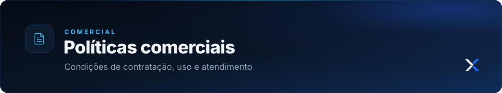

<picture>
  <source media="(max-width: 1103px)" srcset="../assets/banners/doc-politicas-comerciais-mobile.svg">
  
</picture>

<a href="../README.md#nossos-sistemas">Catálogo</a> · <a href="../docs/comandos.md">Comandos</a> · <a href="../docs/planos.md">Planos</a> · <a href="../README.md#contato">Contato</a>

Condições comerciais da MWX Systems para os sistemas MWX Bots. O que não está definido aqui é combinado no atendimento comercial antes da contratação.

## Quem somos

- **MWX Systems** é a identidade institucional e a titular da licença dos sistemas.
- **MWX Bots** é a linha de produtos da MWX Systems.

## Modalidades

| Modalidade | Direito de uso | Hospedagem, suporte e atualizações | Valor |
|---|---|---|---|
| Planos de assinatura | Enquanto a assinatura estiver ativa | Inclusos | Mensal, por servidor ([tabela](planos.md#planos-de-assinatura)) |
| Sistemas individuais | Enquanto a assinatura estiver ativa | Inclusos | Mensal, por servidor ([tabela](planos.md#sistemas-individuais)) |
| Licença em pagamento único | Por tempo indeterminado, conforme as condições contratuais | Hospedagem não inclusa; suporte e atualizações pelo período definido na contratação | Sob consulta |
| MWX Personalizado | Conforme a proposta | Conforme a proposta | Sob consulta |
| MWX Custom | Condições individuais de cada projeto | Conforme o projeto | Sob orçamento |
| Aquisição do código-fonte | Negociação comercial separada | Negociação separada | Negociação separada |

## Direito de uso

- Contratar um plano dá direito ao **uso** dos sistemas no servidor contratado. Não há aquisição da propriedade intelectual.
- O código-fonte não está incluso em assinaturas, licenças em pagamento único, no MWX Personalizado nem no MWX Custom. A aquisição só acontece mediante negociação comercial separada.
- O direito de uso não autoriza revenda nem redistribuição.
- A licença em pagamento único dá direito de uso por tempo indeterminado e **não** significa suporte, hospedagem ou atualizações vitalícios.
- Projetos personalizados têm condições individuais, definidas na proposta.

Texto completo na [licença](../LICENSE.md).

## O que está incluso nas assinaturas

- Hospedagem dos sistemas contratados.
- Suporte e atualizações enquanto a assinatura estiver ativa.
- Instalação e configuração inicial, conforme a seção [Como contratar](../README.md#como-contratar).

## Condições combinadas na contratação

Os pontos abaixo ainda não têm regra publicada. Eles são informados pelo atendimento comercial e combinados **antes** da contratação, e esta página será atualizada quando forem definidos:

- Renovação das assinaturas, mensalidades vencidas, suspensão e reativação.
- Cancelamento e reembolsos.
- Migração entre planos e transferência entre servidores.
- Prazo de instalação.
- Horário de atendimento e limites do suporte.
- Personalizações inclusas e serviços cobrados à parte.

## Atendimento

Todos os atendimentos começam no [servidor da MWX no Discord](https://discord.gg/xbDNJy6mtC). Informe o assunto ao chamar:

- **Comercial:** contratação, assinaturas, licenças, orçamentos e planos personalizados.
- **Suporte técnico:** instalação, configuração, dúvidas e problemas técnicos de clientes.
- **Projetos exclusivos:** desenvolvimento personalizado, novos sistemas e funcionalidades exclusivas.

E-mail: contato.mwxsystems@gmail.com · Atendimento em português.

Sobre os dados guardados pelos sistemas, veja <a href="privacidade-e-dados.md">Privacidade e dados</a>.

 

<picture></picture>

<a href="../README.md#nossos-sistemas"><b>← Voltar ao catálogo</b></a> · <a href="../docs/planos.md">Conhecer os planos</a> · <a href="../README.md#contato">Falar com a MWX</a>

© 2026 MWX Systems · Sua organização. Nossa tecnologia.

