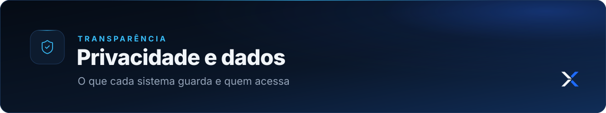

<picture>
  <source media="(max-width: 1103px)" srcset="../assets/banners/doc-privacidade-e-dados-mobile.svg">
  
</picture>

<a href="../README.md#nossos-sistemas">Catálogo</a> · <a href="../docs/comandos.md">Comandos</a> · <a href="../docs/planos.md">Planos</a> · <a href="../README.md#contato">Contato</a>

Esta página descreve, com base na implementação dos sistemas, quais dados eles guardam e onde. Ela não é uma política de privacidade completa nem uma declaração de conformidade com a LGPD: as regras de retenção, exclusão e backup da hospedagem ainda estão em definição e são informadas no atendimento comercial.

## O que cada sistema guarda

| Sistema | Dados guardados | Onde |
|---|---|---|
| MWX Management | Configurações do servidor; advertências; registros de membros (nome, sobrenome e ID do jogo, conforme o formato definido); pedidos de ausência; controle de efetivo (entradas, saídas e quem recrutou); blacklist por ID do jogo; confirmações de presença | Arquivos JSON |
| MWX Atendimento | Configurações; registro de cada ticket (autor, assunto e canal); recrutamentos (ID, nome e avatar do candidato, respostas e nota da prova); perguntas do recrutamento | Arquivos JSON |
| MWX Bate-Ponto | Configurações; registros de expediente (ID, nome e avatar do membro, início, pausas e fim) | PostgreSQL |
| MWX Farm | Configurações; registros de farm (ID do membro, nome e ID do personagem, material, quantidade, status, quem analisou, motivo e nome do arquivo de prova); ranking do mês | Arquivos JSON |
| MWX Encomendas | Configurações; catálogo de produtos; pedidos (ID e nome do cliente, itens, valores, status e quem atendeu) | PostgreSQL |
| MWX Denúncias | Configurações; denúncias (protocolo, autor, ID do jogo do denunciado, relato e prova informados, quem analisou e decisão) | Arquivo JSON |

Os sistemas não guardam tokens, senhas de membros nem dados de pagamento.

## Dados que ficam no Discord

Logs, painéis, provas enviadas como anexo e transcripts de tickets são mensagens nos canais do próprio servidor do cliente. Eles seguem as regras e o armazenamento do Discord, e quem os vê depende das permissões de canal definidas pelo cliente.

## Quem tem acesso

- **No servidor:** os membros com os cargos e canais configurados pelo cliente (staff, liderança, logs).
- **Na hospedagem:** nas assinaturas, a MWX opera a hospedagem e tem acesso técnico aos arquivos e ao banco de dados dos sistemas contratados.
- **Na licença em pagamento único:** os sistemas rodam na hospedagem do cliente, sob a responsabilidade dele.

## Exportação

- **MWX Bate-Ponto:** planilha de horas em .xlsx.
- **MWX Farm:** planilha do farm em .xlsx.
- **MWX Atendimento:** transcript em HTML de cada ticket encerrado, enviado ao canal de logs e ao autor do ticket.

A exportação dos demais registros é tratada no atendimento.

## Backup, retenção e exclusão

- **Backup:** os sistemas não fazem backup automático. Quando um arquivo de dados não pode ser lido, o sistema guarda uma cópia dele antes de continuar. A rotina de backup da hospedagem MWX ainda está em definição.
- **Retenção:** os sistemas não apagam registros sozinhos. A exceção são as advertências do MWX Management, que vencem automaticamente depois de um prazo.
- **Exclusão e retenção após o cancelamento:** em definição. Consulte o atendimento.

 

<picture></picture>

<a href="../README.md#nossos-sistemas"><b>← Voltar ao catálogo</b></a> · <a href="../docs/planos.md">Conhecer os planos</a> · <a href="../README.md#contato">Falar com a MWX</a>

© 2026 MWX Systems · Sua organização. Nossa tecnologia.

